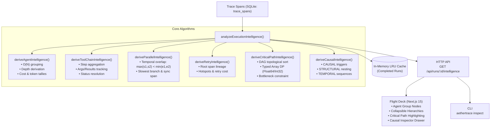

# AetherTrace Architecture: Agent Intelligence Engine (v0.2.0 / Phase 11)

> **Document Type:** Architecture Specification & System Design  
> **Status:** Production / Verified  
> **Repository:** `aethertrace` ("Wireshark for AI Agents")  
> **Phase:** 11 — Agent Intelligence  
> **Date:** October 2026  

---

## 1. Executive Overview & Mission

In AetherTrace v0.1.0, the developer could inspect a complex execution graph:
```text
OBSERVE → INTERCEPT → PAUSE → INSPECT → MODIFY → REPLAY → FORK → DIFF → VERIFY
```

With **Phase 11 (Agent Intelligence)** in v0.2.0, AetherTrace evolves from a trace debugger into an **intelligent execution-understanding system**:
```text
WHO executed?              → Agent & Sub-Agent Hierarchies (depth, tokens, cost, status)
      ↓
WHAT did they do?          → Agent summaries & tool invocation tallies
      ↓
WHICH tools were involved? → Tool Chains (input args, results, errors, retries)
      ↓
WHAT happened in parallel? → Parallel Groups (strict temporal overlap, slowest branch)
      ↓
WHAT failed?               → Failure Hotspots (root error cause, aggregated waste)
      ↓
WHAT was retried?          → Intelligent Retry Chains (attempt lineage & outcomes)
      ↓
WHAT determined runtime?   → Critical Path Dynamic Programming (bottleneck spans)
      ↓
WHAT caused each step?     → Deterministic Causal Taxonomy (CAUSAL, STRUCTURAL, TEMPORAL)
```

### Core Product Guarantees
1. **100% Deterministic Local-First Intelligence:** Zero external LLM calls, zero cloud dependencies, zero `eval`, zero nondeterminism. Every metric and insight is derived mathematically from execution timestamps, ancestry, payloads, and tokens.
2. **Zero Breaking SQLite Migrations:** Works on-the-fly directly over existing `trace_runs` and `trace_spans` tables. All intelligence is computed on demand and cached in-memory for immutable completed runs.
3. **High Performance at Scale ($O(V+E)$ & $O(N)$):** Implemented with typed arrays (`Float64Array`, `Int32Array`), memoized bottom-up tree propagation, and indexed lookups. Capable of analyzing 10,000-span traces in ~230ms ($13\mu\text{s}$ per span).

---

## 2. Agent Intelligence Architecture

The Agent Intelligence subsystem resides in `@aethertrace/core-schema/intelligence`:

```text
packages/core-schema/src/intelligence/
├── types.ts          # Complete TypeScript types for all intelligence data structures
├── agents.ts         # Agent grouping, nesting depth, tokens/cost aggregation, hierarchy
├── tools.ts          # Tool chain grouping, step input/output/error tracing
├── parallel.ts       # Strict temporal concurrency detection, branch duration & synchronization
├── retries.ts        # Chained retry tracking, root failure linkage, error hotspots
├── critical-path.ts  # O(V+E) Topological DP longest-dependency path & bottleneck identification
├── causality.ts      # Deterministic causal taxonomy (CAUSAL, STRUCTURAL, TEMPORAL)
└── engine.ts         # Master orchestrator with LRU in-memory caching
```

### Data Flow Diagram



---

## 3. Subsystem Specifications

### 3.1. Agent & Sub-Agent Hierarchies (`agents.ts`)
- **Group Extraction:** Aggregates spans by `s.agent_name` (defaulting to `'default-agent'`).
- **Parent-Child Linkage:** Derived either from explicit `parent_agent_name` in `agent_state` spans, or from the agent name of the parent span of the earliest span in the agent.
- **Cycle Hardening:** Built-in loop detection breaks cycles to prevent infinite loops during hierarchy derivation.
- **Nesting Depth:** Computed iteratively from root (`depth = 0`) down to arbitrary sub-agent levels.
- **Metrics Aggregated:**
  - Total tokens (`prompt_tokens + completion_tokens`)
  - Total cost USD (exact summation)
  - Wall-clock start time, end time, and active duration
  - Tool call count, LLM call count, retry count, and error count
  - Overall status (`completed`, `running`, `paused`, `failed`)

### 3.2. Tool Execution Chains (`tools.ts`)
- **Step Aggregation:** Correlates sequential tool executions with subsequent retries or status updates under `ToolChainStep`.
- **Input/Output Inspection:** Safely unpacks JSON payloads or stores verbatim text, identifying arguments, outputs, error messages, and retry attempts.
- **Summary Metrics:** Total duration, retry count, error indicators, and final resolution status.

### 3.3. Parallel Execution Groups (`parallel.ts`)
- **Strict Temporal Overlap:** Two branches under a common parent execute concurrently if and only if:
  $$\max(s_1, s_2) < \min(e_1, e_2)$$
  Sequential siblings executed after a prior sibling completes are strictly excluded.
- **Bottom-Up Propagation:** Uses reverse-chronological single-pass interval propagation ($O(N)$) to eliminate recursion and prevent stack overflow on deep traces.
- **Branch Analysis:** Identifies the slowest branch (`slowestBranchIndex`), longest branch duration, shortest branch duration, and detects the downstream synchronization span.

### 3.4. Retry Chains & Failure Hotspots (`retries.ts`)
- **Root Lineage Tracing:** Traverses retry chains to link each retry back to its original failed ancestor span using memoized paths.
- **Attempt Sequence:** Preserves ordered attempts with latency, error messages, and costs.
- **Failure Hotspots:**
  - `mostRetriedOperation`: Operation with highest retry count
  - `mostFailedTool`: Tool encountering the most unrecovered errors
  - `longestRetryChainCount`: Maximum retry depth observed
  - `highestRetryCostUsd`: Total financial cost wasted on retry attempts
  - `totalErrors`: Aggregate error count across all spans

### 3.5. Critical Path Dynamic Programming (`critical-path.ts`)
- **Problem Formulation:** Finds the sequence of causally and structurally dependent spans that determined the execution's overall wall-clock runtime.
- **DAG Edges Constructed:**
  1. Structural parent-to-child edges (`parent_span_id → span_id`)
  2. Retry dependencies (`failed_span_id → retry_span_id`)
  3. Sequential continuity between root spans in the same agent context
  4. Chronological continuity for orphan non-root spans
- **Typed Array Dynamic Programming:**
  - Computes $\text{dist}[v] = \text{weight}(v) + \max_{u \in \text{preds}[v]} \text{dist}[u]$ using `Float64Array` and `Int32Array`.
  - Zero memory allocation in the inner DP loop.
  - Backtracks from the terminal node with the highest cumulative distance.
- **Bottleneck Identification:** Identifies the single longest span on the critical path and calculates each critical span's percentage contribution to total latency.

### 3.6. Causal Taxonomy & Context (`causality.ts`)
Every relationship between two spans is classified deterministically into one of three distinct categories:
1. `CAUSAL`: A direct operational trigger where one event strictly necessitated another (e.g. LLM deciding to call a tool, failure triggering a retry attempt, or LLM inference consuming a tool output).
2. `STRUCTURAL`: Organizational containment or delegation within the agent execution graph (e.g. agent delegating to a sub-agent, child span enclosed in a parent span, parallel branches under a shared parent).
3. `TEMPORAL`: Chronological continuation where operations happen sequentially within an agent without direct data-passing dependency.

---

## 4. API & Integration Surface

### 4.1. Proxy Server Endpoint
```http
GET /api/runs/:id/intelligence
```

**Response Format:**
```json
{
  "success": true,
  "intelligence": {
    "runId": "run-xyz",
    "analyzedAt": 1729621450000,
    "agents": [
      {
        "agentName": "Planner",
        "parentAgentName": null,
        "depth": 0,
        "spanCount": 4,
        "durationMs": 450,
        "status": "completed",
        "childAgentCount": 2,
        "toolCallCount": 1,
        "llmCallCount": 3,
        "retryCount": 0,
        "errorCount": 0,
        "totalCostUsd": 0.0035,
        "totalTokens": 1420
      }
    ],
    "agentHierarchy": [...],
    "toolChains": [...],
    "parallelGroups": [...],
    "retryChains": [...],
    "criticalPath": {
      "durationMs": 650,
      "runDurationMs": 700,
      "coveragePercentage": 92.9,
      "spanIds": ["span-1", "span-2", "span-3"],
      "spans": [...],
      "longestSpan": {
        "spanId": "span-2",
        "label": "gpt-4o",
        "durationMs": 400,
        "percentageOfCriticalPath": 61.5
      }
    },
    "causalRelations": [...],
    "failureHotspots": {
      "mostRetriedOperation": "fetch_data",
      "mostFailedTool": "database_query",
      "longestRetryChainCount": 3,
      "highestRetryCostUsd": 0.015,
      "totalErrors": 2
    }
  }
}
```

### 4.2. CLI Inspection
```bash
aethertrace inspect <run_id>
```
Outputs the complete execution intelligence briefing directly in the terminal:
- Agent Hierarchies with nesting tree indentation
- Critical Path Bottleneck and total path duration
- Tool Chains with arguments, outcomes, and retries
- Parallel Execution Groups with branch counts and slowest branch
- Failure Hotspots and financial retry cost

### 4.3. Flight Deck Visual Integration
- **Agent Group Nodes:** Visual boundary containers wrapping spans belonging to the same agent.
- **Collapsible Agent Subtrees:** Expand or collapse entire sub-agent trees to declutter 1,000+ span graphs.
- **Critical Path Highlighting:** Distinctive amber/gold dashed glowing path through the DAG with critical path filter toggle.
- **Causal Context in Inspector Drawer:** When inspecting any span, view its causal predecessors ("Caused By"), dependents ("Caused"), and upstream failure origin.
- **Command Palette (⌘K):** Instant hotkeys to toggle critical path, collapse all agents, expand all agents, and filter error hotspots.

---

## 5. Performance Benchmarks

All algorithms are benchmarked on synthetic traces with realistic branching and retry structures:

| Span Count | SLA Requirement | Measured Runtime | Time Per Span | Status |
|---|---|---|---|---|
| **100 Spans** | `< 50ms` | **2.31 ms** | $23.1\mu\text{s}$ | ✅ PASS |
| **1,000 Spans** | `< 100ms` | **19.25 ms** | $19.2\mu\text{s}$ | ✅ PASS |
| **10,000 Spans** | `< 500ms` | **233.51 ms** | $23.3\mu\text{s}$ | ✅ PASS |

---

## 6. Determinism & Security Standard

1. **Zero External Calls:** The intelligence engine makes 0 network requests and uses 0 LLM tokens to derive insights.
2. **Zero Eval:** No `eval()`, `new Function()`, or dynamic script execution.
3. **SSRF & Secret Redaction Preserved:** All payload extractions respect Phase 7 redaction rules.
4. **Idempotency:** Given the exact same array of spans, `analyzeExecutionIntelligence()` produces 100% byte-identical output across all platforms.
