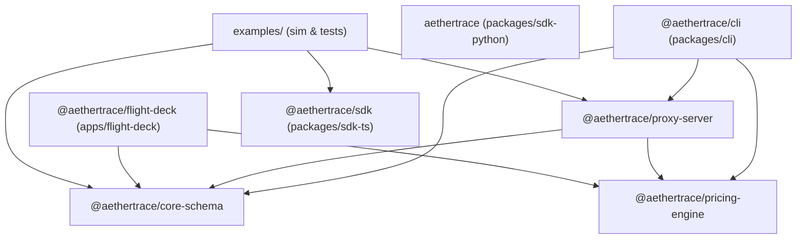

# AetherTrace Architecture: Current State Baseline (v0.3.0)

> **Document Type:** Architecture Baseline & Technical Audit  
> **Status:** Active / Verified  
> **Repository:** `aethertrace` ("Wireshark for AI Agents")  
> **Date:** October 2026  

---

## 1. Executive Overview

**AetherTrace** is a local-first telemetry proxy, visual execution debugger, and time-travel replay engine designed specifically for multi-agent workflows. It operates as an HTTP/WebSocket reverse proxy situated between AI agent runtimes (LangChain, AutoGen, CrewAI, OpenAI Swarm, custom scripts) and LLM providers (OpenAI, Anthropic, Ollama, vLLM).

### Key Architectural Tenets
1. **100% Local-First & Zero External Cloud Dependencies:** All persistent storage resides in a single, high-performance local SQLite database (`.trace.sqlite`). No cloud accounts, SaaS API keys, or external telemetry collectors are required.
2. **Deterministic Time-Travel Replay & Branching:** By computing canonical SHA-256 hashes of input requests `(model + messages + tools + hyperparameters)`, AetherTrace enables instant $0.00 replay from cache and DAG forking at any historical span.
3. **Active Burp-Suite-Style Live Interception:** Beyond passive logging, AetherTrace can pause in-flight HTTP connections at pre-configured breakpoints, allowing human operators to mutate prompts or mock responses before upstream forwarding.
4. **Chaos Fault Injection:** A built-in chaos engine allows simulating synthetic rate limits (HTTP 429), upstream outages (HTTP 502), latency spikes, and malformed JSON payloads to test agent fault tolerance.
5. **Deterministic CI Regression Testing:** Portable `.trace.json` bundles (analogous to Wireshark `.pcap` files) can be asserted in CI/CD pipelines to enforce hard cost ceilings and latency SLAs.

---

## 2. Monorepo Structure & Package Topology

The repository is organized as a Turborepo monorepo powered by `pnpm@9.x` workspaces.

```text
aethertrace/
├── apps/
│   ├── flight-deck/             # Next.js 15 visual telemetry dashboard (Port 3000)
│   └── proxy-server/            # Hono + WebSocket interceptor proxy (Port 4000)
├── packages/
│   ├── core-schema/             # Shared SQLite schema, Drizzle ORM, hashing & diff logic
│   ├── pricing-engine/          # Zero-dependency USD token cost calculator
│   ├── sdk-ts/                  # TypeScript SDK with AsyncLocalStorage context propagation
│   ├── sdk-python/              # Python SDK with contextvars context propagation
│   └── cli/                     # `aethertrace` binary (start, sim, diff, assert, export, import)
├── examples/                    # E2E test suites, smoke tests, and multi-agent simulators
├── scripts/                     # Operational & capture automation scripts
├── .github/workflows/           # GitHub Actions CI workflow
├── Dockerfile                   # Multi-stage production container build
├── turbo.json                   # Turborepo task pipeline definition
├── pnpm-workspace.yaml          # PNPM workspace definition
└── tsconfig.base.json           # Shared TypeScript configuration
```

### Dependency Graph



---

## 3. Core Subsystems Deep Dive

### 3.1. The Interceptor Proxy (`apps/proxy-server`)
- **Runtime:** Node.js (v20+) using `@hono/node-server` and `ws` on port `4000`.
- **CORS:** Configured globally with `origin: '*'` allowing cross-origin calls from Flight Deck (`localhost:3000`) and arbitrary local agent runtimes.
- **Routes:**
  - `POST /v1/chat/completions` & `POST /chat/completions`: Intercepts OpenAI-compatible requests.
  - `GET /health`: Healthcheck, uptime, and connected WebSocket client count.
  - `GET /api/runs`: Returns paginated trace runs with optional status filtering.
  - `GET /api/runs/:id`: Returns single run details.
  - `GET /api/runs/:id/spans`: Returns all spans belonging to a run in chronological order.
  - `GET /api/runs/:baseId/diff/:targetId`: Returns a structured side-by-side diff and executive scorecard between two runs.
  - `GET /api/runs/:id/export`: Exports a self-contained `.trace.json` bundle.
  - `POST /api/runs/import`: Imports and reconstructs a `.trace.json` bundle into local SQLite.
  - `GET /api/spans/:id`: Returns metadata for a single span.
  - `POST /api/spans/:id/fork`: Clones ancestor spans into a new run and branches execution from that point.
  - `GET /api/stats`: Aggregates global telemetry metrics (run count, total spend, tokens, cache hit rate, average latency).
  - `GET /api/breakpoints` & `PUT /api/breakpoints/config`: Fetches or updates breakpoint rules.
  - `POST /api/breakpoints/:spanId/resolve`: Resumes, mocks, or aborts a held breakpoint request.
  - `GET /api/chaos/config` & `PUT /api/chaos/config`: Fetches or updates chaos fault injection rates.

#### Supported Request Headers
| Header | Description | Default / Example |
|---|---|---|
| `X-Run-Id` | Groups spans into a logical trace run session | Auto-generated UUID |
| `X-Run-Name` | Human-readable name for the trace run | `<agentName>-session` |
| `X-Parent-Span-Id` | Links span to parent DAG node | `null` (root node) |
| `X-Agent-Name` | Identifier for calling agent role | `'default-agent'` |
| `X-Max-Budget-USD` | Hard budget limit for the run session | Unlimited (e.g. `0.10`) |
| `X-Replay-Mode` / `X-Replay-Cache` | If `'true'`, bypasses upstream if request hash exists | `'false'` |
| `X-Mock-Upstream` | Returns synthetic mock response without spending API keys | `'false'` |
| `X-Breakpoint` | Forces immediate breakpoint hold on the request | `'false'` |
| `X-Chaos-Inject` | Injects synthetic fault (`rate_limit`, `upstream_500`, `latency:<ms>`, `corrupt_json`) | None |
| `X-Target-Base-URL` | Overrides upstream endpoint destination | `https://api.openai.com/v1` |

---

### 3.2. Trace Storage & SQLite Engine (`packages/core-schema`)
- **Driver:** `better-sqlite3` combined with `drizzle-orm`.
- **Database File:** Local `.trace.sqlite` located in root working directory (configurable via `AETHERTRACE_DB_PATH`).
- **Pragmas Configured:**
  - `PRAGMA journal_mode = WAL;` (Write-Ahead Logging for high-concurrency read/write)
  - `PRAGMA foreign_keys = ON;` (Cascading deletes from runs to spans)
  - `PRAGMA synchronous = NORMAL;` (High durability with reduced fsync overhead)
  - `PRAGMA busy_timeout = 5000;` (Handles multi-process locking gracefully)
- **Automatic Migration:** In `db.ts`, `runAutoMigration(sqlite)` executes idempotent DDL creating tables and indexes on first connection.

#### Table Schemas

##### `trace_runs`
| Column | Type | Constraints / Defaults | Description |
|---|---|---|---|
| `id` | TEXT | PRIMARY KEY | Unique Run UUID (`run_...`) |
| `name` | TEXT | NOT NULL DEFAULT `'default-run'` | Run session display name |
| `status` | TEXT | NOT NULL DEFAULT `'running'` | Enum: `running`, `paused`, `completed`, `failed`, `breaker_tripped` |
| `total_tokens` | INTEGER | NOT NULL DEFAULT 0 | Cumulative token counter |
| `total_cost_usd` | REAL | NOT NULL DEFAULT 0.0 | Cumulative spend in USD |
| `parent_run_id` | TEXT | NULLABLE | Source run ID if created via Fork |
| `forked_at_span_id`| TEXT | NULLABLE | Source span ID where branch split |
| `created_at` | INTEGER | NOT NULL | Millisecond timestamp |

*Indexes:* `trace_runs_created_at_idx`, `trace_runs_status_idx`, `trace_runs_parent_idx`.

##### `trace_spans`
| Column | Type | Constraints / Defaults | Description |
|---|---|---|---|
| `id` | TEXT | PRIMARY KEY | Unique Span UUID (`span_...`) |
| `run_id` | TEXT | NOT NULL, FK -> `trace_runs.id` ON DELETE CASCADE | Parent run identifier |
| `parent_span_id` | TEXT | NULLABLE | Ancestor span ID in execution DAG |
| `span_type` | TEXT | NOT NULL DEFAULT `'llm_call'` | Enum: `llm_call`, `tool_call`, `agent_state`, `guardrail_block` |
| `agent_name` | TEXT | NOT NULL DEFAULT `'default-agent'` | Agent identity (e.g. Planner, Coder) |
| `model` | TEXT | NULLABLE | Model identifier (e.g. `gpt-4o`) |
| `request_payload` | TEXT | NULLABLE | Stringified JSON request payload |
| `response_payload`| TEXT | NULLABLE | Stringified JSON response payload |
| `prompt_tokens` | INTEGER | DEFAULT 0 | Prompt token count |
| `completion_tokens`| INTEGER | DEFAULT 0 | Completion token count |
| `cost_usd` | REAL | DEFAULT 0.0 | Calculated cost in USD |
| `latency_ms` | INTEGER | DEFAULT 0 | Roundtrip latency in milliseconds |
| `cache_hit` | INTEGER | NOT NULL DEFAULT 0 | 1 if replayed from cache; 0 if live |
| `request_hash` | TEXT | NOT NULL | Canonical SHA-256 request hash |
| `created_at` | INTEGER | NOT NULL | Millisecond timestamp |

*Indexes:* `trace_spans_run_id_idx`, `trace_spans_request_hash_idx`, `trace_spans_parent_idx`, `trace_spans_created_at_idx`.

---

### 3.3. Pricing Engine (`packages/pricing-engine`)
- **Zero External Dependencies:** Implements exact pricing in pure TypeScript without network calls.
- **Supported Providers & Models:**
  - **OpenAI:** `gpt-4o`, `gpt-4o-mini`, `gpt-4-turbo`, `gpt-4`, `gpt-3.5-turbo`, `o1`, `o1-mini`, `o3-mini`, with dated-snapshot fallback matching.
  - **Anthropic:** `claude-3-5-sonnet`, `claude-3-5-haiku`, `claude-3-opus`, `claude-3-sonnet`, `claude-3-haiku`.
  - **Local Models ($0.00):** `llama3`, `llama3.1`, `llama3.2`, `mistral`, `mixtral`, `deepseek-r1`, `deepseek-v3`, `qwen`, `qwen2.5`, `phi3`.
- **Output:** Returns exact `promptCost`, `completionCost`, and `totalCost` computed up to 8 decimal places.

---

### 3.4. Replay, Forking & Circuit Breakers

#### Deterministic Hashing (`packages/core-schema/src/hash.ts`)
- Recursively normalizes and sorts object keys via `canonicalStringify()`.
- Extracts `(model, messages, tools, tool_choice, temperature, response_format)`.
- Produces a 64-character SHA-256 hexadecimal hash invariant to key order or whitespace formatting.

#### Replay Cache (`apps/proxy-server/src/services/cache.ts`)
- When `X-Replay-Mode: true` is provided, queries SQLite for the latest span matching `request_hash`.
- If found, delivers the cached payload in **0ms** latency with **$0.00** cost and records a new span with `cache_hit = 1`.
- Fully supports OpenAI SSE streaming replay via `createReplayStreamChunks()`.

#### Time-Travel Forking (`POST /api/spans/:id/fork`)
- Given a target `spanId`, copies all ancestor spans occurring prior to the fork into a new `trace_runs` session.
- Sets `parent_run_id` and `forked_at_span_id`.
- Re-marks ancestor spans as cached hits in the child branch.
- Returns `newRunId`, enabling the developer to modify prompts or substitute models from the fork point onward.

#### Circuit Breakers (`apps/proxy-server/src/services/breaker.ts`)
1. **Financial Ceiling:** Compares current run spend `total_cost_usd` against `X-Max-Budget-USD`. If exceeded, trips with HTTP 429 (`budget_exceeded`).
2. **Semantic Loop Breaker:** Detects if an agent repeatedly makes identical requests by tracking consecutive `request_hash` matches. If repeated >= 3 times consecutively, trips with HTTP 429 (`loop_detected`).
3. Tripped breakers insert a `guardrail_block` span, set `status = 'breaker_tripped'`, and broadcast `CIRCUIT_BREAKER_TRIPPED` over WebSocket.

---

### 3.5. Live Breakpoint Interceptor (`apps/proxy-server/src/services/breakpoints.ts`)
- Implements Burp-Suite-style mid-flight request holding:
  1. If `X-Breakpoint: true` or active rule matches `agentName` / `model`, the proxy intercepts before calling upstream.
  2. Creates span with `span_type: 'llm_call'` and initial status `intercepted`.
  3. Updates run status to `paused`.
  4. Stores an in-memory deferred Promise in `pendingBreakpoints = Map<string, PendingHold>`.
  5. Broadcasts `BREAKPOINT_HIT` over WebSocket to Flight Deck.
  6. The HTTP connection remains open, waiting for operator action.
- Operator Resolutions (`POST /api/breakpoints/:spanId/resolve`):
  - **Resume (`action: "resume"`):** Optionally applies mutated request payload (`modifiedPayload`), re-computes hash, updates span in SQLite, and forwards to upstream.
  - **Mock (`action: "mock"`):** Returns mocked completion immediately to caller with $0.00 cost and 0ms latency.
  - **Abort (`action: "abort"`):** Closes held request with HTTP 403, recording a `guardrail_block` span.

---

### 3.6. Chaos Engineering Engine (`apps/proxy-server/src/services/chaos.ts`)
- Evaluates per-request headers (`X-Chaos-Inject`) or global probabilistic configuration (`/api/chaos/config`).
- **Fault Types:**
  - `rate_limit`: Returns synthetic HTTP 429 Rate Limit error.
  - `upstream_500`: Returns synthetic HTTP 502 Bad Gateway error.
  - `latency`: Inserts artificial sleep delay (e.g. 2000ms) before processing.
  - `corrupt_json`: Returns malformed, unclosed JSON syntax to verify agent parsing resilience.

---

### 3.7. Run Diffing Arena (`packages/core-schema/src/diff.ts`)
- Side-by-side comparative analysis between any two runs (e.g. Base Run vs Time-Travel Fork).
- **Step-by-step Classification:**
  - `identical_cached`: Exact SHA-256 match, 0ms latency, $0.00 cost.
  - `modified_fork`: The fork point where model or prompt was mutated.
  - `diverged_downstream`: Subsequent steps executed after the fork point.
- **Executive Scorecard:** Computes total cost delta, token delta, latency delta, and percentage cost savings.

---

### 3.8. Distribution CLI (`packages/cli`)
- Invoked via `npx aethertrace <command>` or `pnpm cli <command>`.
- **Command Set:**
  - `aethertrace start [-p <port>]`: Starts proxy server and WebSocket broadcaster.
  - `aethertrace sim`: Executes an autonomous 5-step multi-agent simulation.
  - `aethertrace diff <base_id> <target_id>`: Displays executive scorecard and aligned DAG table in terminal.
  - `aethertrace assert <trace.json> [--max-cost <usd>] [--max-latency <ms>]`: Deterministic CI assertion gate; exits with code `0` on pass or code `1` on failure.
  - `aethertrace export <run_id> [-o <file>]`: Exports run to `.trace.json`.
  - `aethertrace import <file.json>`: Imports `.trace.json` into local SQLite.

---

### 3.9. SDKs
- **TypeScript SDK (`packages/sdk-ts`):**
  - Utilizes Node.js `AsyncLocalStorage` for zero-overhead, asynchronous context propagation.
  - Provides `traceRun(name, fn)`, `traceAgent(agentName, fn)`, `withSpan(spanId, fn)`.
  - Provides `wrapOpenAI(client)` to automatically reroute client to `http://localhost:4000/v1` and inject propagation headers into all API calls.
  - Provides `createTracedFetch()` for standard `fetch` workflows.
- **Python SDK (`packages/sdk-python`):**
  - Utilizes standard library `contextvars` for thread-safe and async-safe context propagation.
  - Provides `@trace_run` and `@trace_agent` decorators and context managers.
  - Provides `get_trace_headers()` and `get_trace_context()`.

---

### 3.10. Flight Deck UI (`apps/flight-deck`)
- **Framework:** Next.js 15 (App Router, React 19, TypeScript `strict: true`, Tailwind CSS).
- **Visualization:** `@xyflow/react` (React Flow v12) + `dagre` for automated hierarchical DAG layout (supports Top-to-Bottom and Left-to-Right orientation).
- **Brand Aesthetic:** Sleek, modern monochrome/grayscale palette:
  - Canvas background: `#09090b` (true dark zinc)
  - Card surfaces: `#121214` and `#18181b`
  - High-contrast pure white (`#ffffff`) accents, badges, and glowing edge connections
  - Status color coding: Green (completed), Amber (breakpoint intercepted), Red (circuit breaker tripped).
- **Real-Time Streaming:** Subscribed to `ws://localhost:4000/ws` with auto-reconnect; updates DAG nodes, telemetry metrics, and sidebar dynamically without page reloads.
- **Modals & Drawers:**
  - `InspectorDrawer`: Span metrics, deterministic hash copy, JSON request/response inspector, Time-Travel Fork IDE, and Breakpoint Resolution controls.
  - `DiffArenaModal`: Side-by-side run selection, summary scorecard, and step-by-step diff inspection.
  - `ChaosModal`: Interactive sliders for fault probabilities and latency spikes.

---

### 3.11. CI & Docker
- **Continuous Integration (`.github/workflows/ci.yml`):**
  - Runs on `ubuntu-latest` with Node 22 and `pnpm@9.15.4`.
  - Verifies: `pnpm check-types` -> `pnpm build` -> `pnpm test:smoke` -> `pnpm test:e2e` -> `pnpm test:phase4` -> `pnpm test:phase5`.
- **Docker (`Dockerfile`):**
  - Multi-stage build starting from `node:22-bookworm-slim`.
  - Prepares `pnpm@9.15.4` via corepack.
  - Installs compilation dependencies (`python3`, `make`, `g++`) for `better-sqlite3`.
  - Builds all packages via Turborepo.
  - Exposes ports `3000` (UI) and `4000` (Proxy).

---

### 3.12. Git & Execution Reproducibility Engine (`packages/core-schema`, `packages/cli`, `apps/flight-deck`)
- **Metadata Capture:** Automatically captures local git metadata (`commit_sha`, `short_sha`, `branch`, `dirty`, `detached_head`, `git_version`, `source_fingerprint`), runtime environment (`node`, `version`, `os`, `architecture`, `package_manager`), and dependency lockfiles (`pnpm-lock.yaml`, `package-lock.json`, etc.) upon run creation, replay, and fork.
- **Deterministic Source Fingerprint:** Computes a SHA-256 hash combining commit SHA and sorted, sanitized `git status -u` porcelain lines. Excludes test databases and secret keys.
- **Secret Safety Denylist:** Categorically excludes `.env*`, `*.pem`, `*.key`, `id_rsa`, and token/password/credential patterns from hashes and exports.
- **Reproducibility Evaluation:** Analyzes run provenance into classified states (`reproducible`, `reproducible_with_warnings`, `source_changed`, `dependencies_changed`, `environment_changed`, `dirty_worktree`, `incomplete`, `unknown`).
- **CLI Suite:** Introduces `aethertrace inspect`, `aethertrace provenance`, `aethertrace compare`, and `aethertrace reproduce`.
- **Flight Deck Integration:** Run Provenance card in `InspectorDrawer` and multi-dimensional Provenance comparison in `DiffArenaModal`.

---

### 3.13. Security & Trust Engine (`packages/core-schema/src/security`, `apps/proxy-server`, `apps/flight-deck`)
- **Zero-Eval Sandbox:** Breakpoint condition evaluation and dynamic span property access (`safeGetProperty`) run with a strict ban on `eval()` and `Function()`. Blocks prototype pollution vectors (`__proto__`, `constructor`, `prototype`, `globalThis`, `process`).
- **Secret Redaction Pipeline:** High-confidence multi-pattern scanner for OpenAI, Anthropic, AWS, Google, GitHub, GitLab, JWT/Bearer, PEM private keys, and database connection strings. Recursive deep redaction preserves operational metrics (`prompt_tokens`, `total_tokens`) while sanitizing sensitive payload keys. Handles circular object references safely.
- **SSRF Shield:** Validates proxy targets (`x-target-url`, `x-target-base-url`) and follows redirects securely. Categorically blocks loopback (`127.0.0.1`), RFC 1918 private subnets, cloud metadata IP (`169.254.169.254`), and hex/decimal obfuscations.
- **Header & URL Sanitization:** Denylists sensitive request/response headers (`Authorization`, `Cookie`, `X-Api-Key`) and scrubs authentication credentials from URL query parameters. Validates link URI schemes, blocking dangerous schemes (`javascript:`, `data:`, `file:`).
- **Replay Safety & Cost Confirmation Gate:** Classifies tool side-effects into `pure`, `read_only`, `mutating`, and `unknown`. Enforces `cache_only`, `safe_replay`, or `live_replay` policies. Computes pre-replay projected cost and strictly requires explicit developer confirmation (`confirm_live: true`) before live tokens can be billed.
- **Resource Bounds & DoS Hardening:** Maximum limits on span payloads (512 KB), request bodies (10 MB), bundle imports (50 MB), spans per run (5,000), nesting depth (32 levels), and identifier validation (`/^[a-zA-Z0-9_\-\.]{1,128}$/`).
- **Security Audit Telemetry:** In-memory ring buffer (500 events) recording security events (`secret_redacted`, `ssrf_blocked`, `breakpoint_condition_blocked`, etc.) exposed via `GET /api/security/audit`, `GET /api/security/status`, and Flight Deck's TopBar security shield indicator.

---

### 3.14. Search & Developer UX Engine (`packages/core-schema/src/search`, `apps/proxy-server`, `apps/flight-deck`, `packages/cli`)
- **Zero-Eval Query Parser:** AST-based deterministic tokenizer for free-text, quoted phrases, field filters (`agent:`, `model:`, `tool:`, `run:`, `span:`, `branch:`, `commit:`), numeric operators (`cost:>0.10`, `cost:<1.0`, `tokens:>1000`), durations (`duration:>3s`, `duration:<500ms`), dates (`before:`, `after:`), and negation (`-status:completed`). Zero reliance on `eval()` or `Function()`.
- **SQLite FTS5 Full-Text Indexing:** Fast local inverted index over projected titles and sanitized contents with BM25 relevance ranking. Incremental projection synchronization on span commits, trace imports, and replays.
- **Secret Redaction Guarantee:** All indexed projections are strictly processed through Phase 7 redaction pipelines (`redactValue`, `redactString`). Plaintext credentials never enter `trace_search` and cannot be recovered via search queries.
- **Deterministic Ranking Model:** Strict explainability hierarchy: Exact ID match (`100`) > Exact Name/Title match (`80`) > Prefix match (`60`) > FTS5 / Token match (`40`) > Recency tie-breaker (`timestamp DESC`).
- **Cross-Run Error Discovery:** Aggregates error patterns and breaker trips across trace history (`discoverErrors`). Reconstructs upstream causal ancestry chains (`getErrorCausalChain`).
- **Saved Searches & Quick Views:** SQLite-backed saved search views (`saved_searches`) pre-seeded with failure, high-cost, high-latency, tool, and LLM filters.
- **Unified ⌘K Command Palette:** Expanded `⌘K` palette combines live asynchronous search across runs, spans, errors, tools, models, and provenance with instant deep-linking to DAG nodes, timeline scrolling, and Inspector drawers, alongside command actions (`> action`).
- **CLI Search & Discovery:** `aethertrace search "<query>" [--limit <n>] [--json]`, `aethertrace search rebuild`, and `aethertrace errors [--limit <n>] [--json]`.

---

### 3.15. Design System & Product UX Engine (`apps/flight-deck/src/design-system`, `apps/flight-deck/src/components`)
- **Visual Direction & Brand Identity:** Grounded in a high-density, technical aesthetic ("Wireshark for AI Agents"). Banned generic purple/blue gradients, neon glow outlines, glassmorphism blurs, and oversized border radii (>8px).
- **Centralized Design System Tokens (`tokens.ts`):**
  - **Surfaces:** Dark slate/zinc hierarchy (`canvas: #09090b`, `surface: #111114`, `surfaceElevated: #18181c`, `surfaceHover: #222228`, `surfaceActive: #272730`).
  - **Borders:** Crisp, low-contrast 1px technical lines (`subtle: #202024`, `default: #2c2c32`, `strong: #3f3f48`, `focus: #71717a`).
  - **Semantic Event Taxonomy:** Standardized colors for all 8 categories (`LLM`, `TOOL`, `AGENT`, `HTTP`, `USER`, `SYSTEM`, `RETRY`, `ERROR`).
  - **Execution State Indicators:** Standardized dots, labels, and badges for all 5 statuses (`running` with live ping pulse, `completed`, `failed`, `paused`, `intercepted`).
  - **Lineage Classification:** Semantic tags for all 6 origins (`original`, `cached_replay`, `modified`, `new_execution`, `mocked`, `forked`).
- **Reusable Component Primitives:**
  - 13 strongly-typed primitives in `apps/flight-deck/src/design-system/`: `Button`, `IconButton`, `Badge`, `StatusIndicator`, `Input`, `Select`, `Panel` (with `PanelHeader`, `PanelBody`, `PanelFooter`), `Modal`, `Divider`, `DataRow`, `EmptyState`, `LoadingState`, and `Tooltip`.
- **Keyboard-First Navigation & Accessibility:**
  - Standardized keyboard shortcuts (`⌘K` for Command Palette, `T` for Timeline waterfall, `B` for Breakpoints, `D` for Diff Arena, `C` for Chaos, `E` for Trace Export, `Space` for Pause/Resume, `↑/↓` and `J/K` for Span DAG navigation, `Esc` for dismissal).
  - Explicit `:focus-visible` styling with high-contrast outlines for accessible focus rings.
  - Complete `@media (prefers-reduced-motion: reduce)` compliance, eliminating CSS transitions and animations for users with motion sensitivity.
- **Flight Deck Surface Migration:**
  - `TopBar`: Compact 48px header (`h-12`) with monospace typography, StatusIndicator, live security audit badge, and prominent `⌘K` trigger.
  - `RunSidebar`: Monospace metrics, cost delta tags, lineage origin badges, and filter search.
  - `SpanNode`: Semantic category borders, Badge taxonomy, monospace token/cost metrics, and zero neon glows.
  - `DagCanvas`: Subtle grid background with automated Top-to-Bottom / Left-to-Right layout toggling.
  - `Timeline`: High-density waterfall time-offset visualization synchronized bidirectionally with the DAG.
  - `InspectorDrawer`: Structured key-value `DataRow` metadata with one-click copy, JSON payload viewer, and Fork/Replay IDE.
  - `CommandPalette`: Instant filter chips, deep-link navigation to runs and spans, and command execution.
  - `DiffArenaModal`: Side-by-side run comparison matrix with executive spend/latency/lineage scorecards and provenance diff reproducibility indicators.

---

### 3.16. Open Source Productization & Release Engineering (`docs/`, `examples/`, `.github/`, `scripts/`, `Dockerfile`, `compose.yaml`)
- **Product Readiness Audit:** Complete multi-dimensional readiness audit (`docs/architecture/phase10-readiness-audit.md`) covering installation, CLI distribution, containerization, SDK packaging, example apps, documentation architecture, GitHub community UX, release pipelines, and empirical benchmark profiles.
- **Environment & Docker Topology:**
  - Standardized `.env.example` mapping all real system variables (`PORT`, `AETHERTRACE_DB_PATH`, `OPENAI_API_KEY`, `OPENAI_BASE_URL`, `AETHERTRACE_MOCK`, `AETHERTRACE_AUTH_TOKEN`, `AETHERTRACE_ALLOWED_ORIGINS`, `AETHERTRACE_ALLOW_PRIVATE_NETWORK`, `NEXT_PUBLIC_API_URL`, `NEXT_PUBLIC_WS_URL`).
  - Production multi-stage `Dockerfile` with healthcheck endpoint, persistent `/data` volume, and graceful signal-trapping entrypoint script (`scripts/docker-entrypoint.sh`) ensuring zero SQLite database corruption on container shutdown.
  - Native `compose.yaml` (Docker Compose) multi-port routing (:3000 Flight Deck, :4000 Interceptor Proxy).
- **CLI & SDK Packaging Guardrails:**
  - Distribution package whitelist (`files: ["dist", "README.md", "LICENSE"]`) on `@aethertrace/sdk` and `aethertrace` CLI, preventing SQLite databases or development files from being packaged into npm tarballs.
  - Added CLI `--version`, `-v`, and `version` commands (`aethertrace v0.1.0`) with clean status exit codes.
  - Python SDK package metadata aligned with `__version__ = "0.1.0"` export in `aethertrace/__init__.py`.
- **Standalone Example Suite:**
  - 5 standalone, fully functional example directories in `examples/`:
    - `quickstart/`: Zero-key 3-agent pipeline in 30 seconds.
    - `llm-agent/`: Nested hierarchy and parallel fan-out with auto-context propagation.
    - `tool-calls/`: Autonomous tool execution with structured retry chains.
    - `replay/`: Time-travel cache replay and prompt mutation with cost deltas.
    - `debugging/`: Complete canonical 9-stage debugger loop (`OBSERVE` through `VERIFY`).
- **Comprehensive Documentation Architecture:**
  - Modular documentation tree across `docs/getting-started/`, `docs/guides/`, `docs/sdk/`, `docs/cli/`, `docs/deployment/`, `docs/contributing/`, `docs/performance/`, and `docs/trace-format/`.
  - Detailed empirical benchmark profile (`docs/performance/phase10-profile.md`) demonstrating < 1.5ms span ingestion latency, sub-5ms FTS5 search across 10,000 spans, and 0.00ms cached replay.
- **GitHub Community Standards & Release Automation:**
  - Open source governance files: `CHANGELOG.md`, `CODE_OF_CONDUCT.md`, `CONTRIBUTING.md`, `.github/PULL_REQUEST_TEMPLATE.md`, `.github/ISSUE_TEMPLATE/documentation.md`.
  - Continuous integration across 14 independent test suites (`.github/workflows/ci.yml`).
  - Automated dry-run packaging and release verification (`.github/workflows/release.yml`).
- **Self-Observability System API:**
  - Real-time proxy status endpoint (`GET /api/system/status`) reporting process uptime, memory footprint (RSS, heap total, heap used), database run/span record counts, and active WebSocket client connections.

---

### 3.17. Agent Intelligence Engine (`packages/core-schema/src/intelligence`, `apps/proxy-server/src/routes/traces.ts`, `apps/flight-deck/`)
- **Deterministic Local-First Engine:** 100% mathematical derivation of agent structure and metrics with zero external LLM calls, zero cloud dependencies, and zero `eval`.
- **Subsystem Modules:**
  - `agents.ts`: Groups spans by agent, infers parent-agent hierarchy, calculates nesting depth, and aggregates exact token, cost, tool, retry, and duration metrics.
  - `tools.ts`: Assembles sequential tool invocations into `ToolChain` collections with argument and result payloads, duration tracking, and retry status.
  - `parallel.ts`: Evaluates strict temporal overlap ($\max(s_1, s_2) < \min(e_1, e_2)$) to isolate concurrent branches, identify the slowest branch, and detect post-parallel synchronization spans with zero-recursion bottom-up propagation.
  - `retries.ts`: Traverses chained retries back to origin failed spans, computes failure hotspots (`mostRetriedOperation`, `mostFailedTool`, `longestRetryChainCount`, `highestRetryCostUsd`).
  - `critical-path.ts`: O(V+E) dynamic programming longest dependency path calculator using `Float64Array` and `Int32Array` typed arrays, isolating runtime bottlenecks.
  - `causality.ts`: Classifies inter-span relationships into deterministic `CAUSAL`, `STRUCTURAL`, and `TEMPORAL` taxonomies.
  - `engine.ts`: Master orchestrator with in-memory LRU caching for completed immutable runs.
- **Proxy Server Endpoint:** `GET /api/runs/:id/intelligence` exposing structured intelligence payloads with instant cache hits on repeat reads.
- **Flight Deck Visual Integration:**
  - Visual `AgentGroupNode` containers wrapping agent-specific spans.
  - Interactive collapsible agent hierarchies for decluttering large multi-agent DAGs.
  - Critical Path glowing amber highlight path with one-click filter toggle in header and ⌘K Command Palette.
  - Causal predecessors, successors, and failure origins in the Inspector Drawer.
- **CLI Intelligence Briefing:** `aethertrace inspect <run_id>` formatting complete agent hierarchy trees, critical path bottlenecks, tool chains, parallel groups, and failure hotspots.
- **Scalability & SLAs:** 100 spans in 2.31ms (< 50ms SLA), 1,000 spans in 19.25ms (< 100ms SLA), and 10,000 spans in 233.51ms (< 500ms SLA).

---

### 3.18. Replay & Experiment Studio (`packages/core-schema/src/experiments.ts`, `apps/proxy-server/src/routes/experiments.ts`, `apps/flight-deck/src/components/ExperimentStudio.tsx`, `packages/cli/`)
- **Persistent Experiment Domain:** Full CRUD operations for `experiments` and `experiment_variants` tables in SQLite, with foreign key integrity back to source runs and fork points.
- **Topological Prefix Caching:** Preserves unmutated ancestor spans preceding the fork span at $0.00 spend and 0ms latency with `execution_origin: 'cached_replay'`.
- **Mutation Studio:** Deterministic mutation types (`prompt`, `model`, `tool_args`, `mock_tool`) with dynamic token price recalculation via `@aethertrace/pricing-engine`.
- **Bounded Concurrency & Failure Isolation:** In-memory worker pool with a maximum concurrency limit of 2, isolating variant errors to ensure unperturbed completion of sibling branches.
- **Multi-Variant Comparison Scorecards:** Real-time generation of token, cost, duration, cache hit rate, cost delta %, and duration delta % matrices, integrated with node-level semantic DAG diffing (`< 10ms` SLA).
- **Flight Deck Experiment Studio:** High-density 3-tab modal (`Variants & Mutations`, `Comparison Matrix`, `Replay History`), global hotkey `X`, `⌘K` palette integration, Mutation Studio config modal, and direct links to Diff Arena.
- **CLI Management Suite:** `aethertrace experiment` commands (`list`, `create`, `inspect`, `variant-add`, `run`, `compare`) enabling full terminal-driven experimentation workflows.
- **Security & Safety Guardrails:** Strict Phase 7 enforcement including mutating-tool protection, explicit user confirmation for live replays, SSRF filtering, and security audit trail logging.

---

### 3.19. Evaluation & Optimization Engine (`packages/core-schema/src/evaluation/`, `apps/proxy-server/src/routes/evaluations.ts`, `apps/flight-deck/src/components/EvaluationPanel.tsx`, `packages/cli/`)
- **100% Deterministic & Zero External AI Judges:** No probabilistic LLM-as-a-judge, no cloud evaluators, and no hallucinated scores. Every assertion evaluates to a boolean fact with transparent score derivation (`assertionsPassed / assertionsTotal * 100%`).
- **Zero-Eval Assertion DSL:** Rich parser for comparison operators (`==`, `!=`, `<`, `<=`, `>`, `>=`, `contains`, `not_contains`, `exists`, `not_exists`), duration/currency/token aliases, and tool existence rules (`tool "<name>" must exist`).
- **Security Sandboxing:** Enforces strict property access guards; attempts to access `__proto__`, `constructor`, `prototype`, `globalthis`, or `process` throw immediate Security Violations.
- **Concrete Evidence Attachment:** Every failed or passed assertion attaches concrete evidence: culprit span IDs, actual metric values, expected bounds, and error payloads.
- **Causal Root-Cause Analysis:** Leverages Phase 11 execution intelligence to differentiate root trigger failures from downstream cascade effects (retries, timeouts, parent aborts).
- **Deterministic Error Clustering:** Regex canonicalization normalizing dynamic variables (`<IP>`, `:<PORT>`, `<NUM>`, `<UUID>`, `<PATH>`) with full credential and API token masking.
- **Actionable Optimization Signals:** Deterministically flags cost hotspots, critical path latency bottlenecks, retry storms, prompt token bloat, and sequential tool parallelism opportunities with estimated savings.
- **Flight Deck Evaluation Studio:** High-density 5-tab modal (`Overview & Metrics`, `Assertions`, `Root Cause & Errors`, `Optimization Signals`, `Evaluation History`), hotkey `E`, `⌘K` palette integration, culprit span deep-linking, and JSON/Markdown export.
- **CLI Management & CI Gates:** `aethertrace evaluate` commands (`run`, `assert`, `inspect`, `failures`, `errors`, `optimize`, `compare`, `export`, `list`) with deterministic exit codes (`0` for pass, `1` for fail, `2` for error).
- **Scalability & SLAs:** Full evaluation report generated in 2.99ms (< 100ms SLA, 33x faster).

---

## 4. Architectural Verification Matrix

| Verification Aspect | Command | Status | Result / Notes |
|---|---|---|---|
| **Type Checking** | `pnpm check-types` | **PASSED** | 6/6 packages clean, 0 TypeScript errors |
| **Production Build** | `pnpm build` | **PASSED** | Turborepo built 6/6 packages, Next.js static pages generated |
| **Phase 1 Smoke Test** | `pnpm test:smoke` | **PASSED** | Proxy, SQLite WAL, Replay Cache, Budget & Loop Breakers verified |
| **Phase 3 E2E Test** | `pnpm test:e2e` | **PASSED** | TS SDK `AsyncLocalStorage`, `.trace.json` Export/Import verified |
| **Phase 1 Foundation** | `pnpm test:phase1` | **PASSED** | Trace Foundation, WAL Mode, Concurrent Ingestion, Topological Sort |
| **Phase 2 Execution Model** | `pnpm test:phase2` | **PASSED** | Semantic DAG ancestry, token fidelity, nested & parallel agents |
| **Phase 3 Debugger** | `pnpm test:phase3` | **PASSED** | Interactive debugger, live breakpoints, pause/resume, prompt mutation |
| **Phase 4 Intercept Test**| `pnpm test:phase4` | **PASSED** | Live Breakpoints, Mutation, Mock Override, Chaos Faults verified |
| **Phase 4 Time-Travel** | `pnpm test:phase4-advanced` | **PASSED** | Multi-generation forks, lineage integrity, zero-cost cached replay |
| **Phase 5 Diff & CI Test** | `pnpm test:phase5` | **PASSED** | Side-by-Side Diffing, 63.5% cost delta, CI Assertion Gate verified |
| **Phase 6 Reproducibility**| `pnpm test:phase6` | **PASSED** | Git detection, source fingerprinting, secret safety, CLI reproduction |
| **Phase 7 Security & Trust**| `pnpm test:phase7` | **PASSED** | Zero-eval sandbox, SSRF shield, credential redactor, replay guardrails, audit |
| **Phase 8 Search & UX**    | `pnpm test:phase8` | **PASSED** | Zero-eval parser, FTS5 engine, ranking, error discovery, CLI search, ⌘K |
| **Phase 9 Product UX**     | `pnpm test:phase9` | **PASSED** | Design system tokens, 13 primitives, accessibility, visual surfaces, keyboard contracts |
| **Phase 10 Release Engineering** | `pnpm test:phase10` | **PASSED** | Productization, packaging integrity, standalone examples, CLI flags, system status API |
| **Phase 11 Agent Intelligence** | `pnpm test:phase11` | **PASSED** | Deterministic hierarchies, tool chains, parallel groups, retries, critical path DP, causal taxonomy, 10k scalability |
| **Phase 12 Replay & Experiment Studio** | `pnpm test:phase12` | **PASSED** | Experiment CRUD, 4 mutation types, prefix caching, bounded batch execution, 9.65ms scorecard matrix, persistent replay history |
| **Phase 13 Evaluation & Optimization** | `pnpm test:phase13` | **PASSED** | Zero-eval assertion DSL, evidence attachment, culprit localization, error clustering, root cause, optimization signals, CLI CI gate, 2.99ms SLA |


