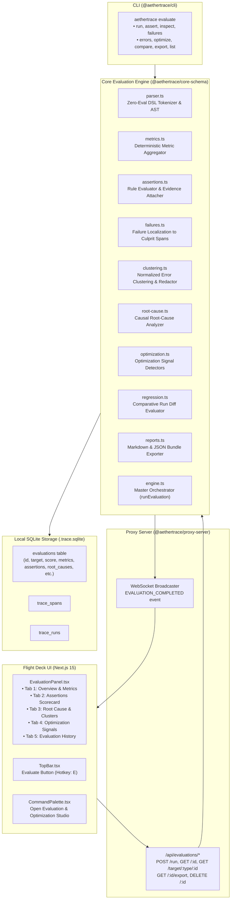

# AetherTrace Architecture: Evaluation & Optimization Engine (v0.2.0 / Phase 13)

> **Document Type:** Architecture Specification & System Design  
> **Status:** Production / Verified  
> **Repository:** `aethertrace` ("Wireshark for AI Agents")  
> **Phase:** 13 — Evaluation & Optimization Engine  
> **Date:** October 2026  

---

## 1. Executive Overview & Mission

In AetherTrace v0.1.0 and v0.2.0 (Phases 11 & 12), developers gained deep structural intelligence and controlled multi-variant replay capabilities:
```text
OBSERVE → UNDERSTAND → FORK → EXPERIMENT → REPLAY → COMPARE
```

With **Phase 13 (Evaluation & Optimization Engine)**, AetherTrace answers the critical engineer question:
> **“Why did my agent perform badly, and exactly what should I change to fix it?”**

Phase 13 transforms AetherTrace into an explainable, local-first agent evaluation and continuous regression optimization environment:

```text
OBSERVE ──> UNDERSTAND ──> EXPERIMENT ──> EVALUATE ──> IDENTIFY FAILURE ──> ANALYZE ROOT CAUSE ──> OPTIMIZE ──> REGRESSION GATE
```

### Core Product Guarantees
1. **100% Deterministic & Zero External AI Judges:** No probabilistic LLM-as-a-judge, no cloud evaluators, and no nondeterministic scoring. Every assertion evaluates to a boolean `passed` or `failed` based on concrete arithmetic and logical facts.
2. **Transparent Scoring:** Scores are derived strictly from arithmetic assertion ratios (`assertionsPassed / assertionsTotal * 100%`), eliminating opaque heuristic quality metrics.
3. **Concrete Evidence Attachment:** Every failure and root cause candidate attaches verifiable evidence: culprit span IDs, metric values, expected bounds, and redacted error messages.
4. **Zero-Eval Sandbox Security:** The assertion DSL parser is strictly zero-eval; dynamic code execution (`eval()`, `new Function()`, VM contexts) and prototype pollution (`__proto__`, `constructor`, `prototype`, `globalThis`) are permanently blocked.
5. **Causal Root Cause Isolation:** Distinguishes primary trigger failures from downstream cascade effects (such as retries, timeouts, and parent aborts) using execution intelligence topologies.
6. **Actionable Optimization Signals:** Deterministically flags cost hotspots, latency critical path bottlenecks, retry storms, prompt token bloat, and sequential tool parallelism opportunities with estimated dollar/latency savings.
7. **CI Regression Gate:** Deterministic CLI exit codes (`0` for passed assertions, `1` for assertion failure, `2` for evaluation or syntax error) enabling automated continuous integration gates.

---

## 2. Architecture & Data Flow

The Evaluation & Optimization Engine integrates across the entire stack:



---

## 3. Zero-Eval Assertion DSL

The assertion parser implements a formal tokenizer and AST evaluator without dynamic code execution.

### 3.1 Supported Operators
| Operator | Semantics | Example |
|---|---|---|
| `==` | Strict equality | `reliability.errorCount == 0` |
| `!=` | Inequality | `status != "failed"` |
| `<` | Less than | `latency_ms < 5000ms` |
| `<=` | Less than or equal to | `cost_usd <= 0.05` |
| `>` | Greater than | `tokens > 1000` |
| `>=` | Greater than or equal to | `score >= 80` |
| `contains` | Substring or array membership | `model contains "gpt-4o"` |
| `not_contains` | Substring or array negation | `error.message not_contains "timeout"` |
| `exists` | Non-null and non-zero existence | `tool "WebSearch" exists` |
| `not_exists` | Absence or zero occurrence | `tool "DeleteUser" not_exists` |

### 3.2 Canonical Field Aliases
Developers can write intuitive, natural aliases that map deterministically to structured JSON paths:
- **Cost:** `cost`, `spend`, `total_cost`, `cost_usd` $\rightarrow$ `cost.totalCostUsd`
- **Cost Delta:** `cost_delta`, `cost_delta_usd` $\rightarrow$ `cost.costDeltaUsd`
- **Latency:** `duration`, `duration_ms`, `latency`, `latency_ms` $\rightarrow$ `latency.totalDurationMs`
- **Critical Path:** `critical_path`, `critical_path_ms`, `bottleneck_duration` $\rightarrow$ `latency.criticalPathMs`
- **Tokens:** `tokens`, `total_tokens` $\rightarrow$ `tokens.totalTokens`
- **Prompt Tokens:** `prompt_tokens`, `input_tokens` $\rightarrow$ `tokens.promptTokens`
- **Completion Tokens:** `completion_tokens`, `output_tokens` $\rightarrow$ `tokens.completionTokens`
- **Errors:** `errors`, `error_count` $\rightarrow$ `reliability.errorCount`
- **Retries:** `retries`, `retry_count` $\rightarrow$ `reliability.retryCount`
- **Tool Exists:** `tool "<Name>" must exist` $\rightarrow$ `execution.byToolCount.<Name> >= 1`

### 3.3 Security Guards
1. **Forbidden Property Blocklist:** Any token matching `__proto__`, `constructor`, `prototype`, `globalthis`, `process`, `require`, `import`, `eval`, `function`, `mainmodule`, `binding` immediately throws a `Security Violation`.
2. **Length Ceiling:** Expressions exceeding 500 characters are rejected before parsing to prevent regex denial-of-service (ReDoS).

---

## 4. Deterministic Metrics Extraction Layer

Every evaluation extracts fact-based metrics directly from trace spans and execution graphs:

```typescript
export interface EvaluationMetrics {
  cost: CostMetrics;          // spend, byModel, byAgent, cachedSavingsUsd
  latency: LatencyMetrics;    // totalDurationMs, criticalPathMs, modelLatencyMs, toolLatencyMs
  tokens: TokenMetrics;       // totalTokens, promptTokens, completionTokens
  reliability: ReliabilityMetrics; // errorCount, failedSpansCount, retryCount, retryRate
  execution: ExecutionMetrics; // spanCount, agentCount, agentMaxDepth, toolCallCount, byToolCount
  rawFieldMap: Record<string, any>;
}
```

- **Topological Critical Path:** Computed via DAG dynamic programming across dependencies and parallel branches.
- **Prefix Cache Savings:** Extracted by computing what tokens and spend were preserved through ancestor caching.
- **Model Dominance:** Summarized per model and per agent to expose single-point cost hotspots.

---

## 5. Root-Cause Analysis & Error Clustering

### 5.1 Deterministic Error Clustering
Dynamic error strings are clustered using regex canonicalization that masks runtime variances while preserving deterministic structural fingerprints:
1. **Secret Masking:** Plaintext API keys (`sk-ant-...`, `sk-...`, `Bearer ...`) are redacted before fingerprinting.
2. **UUID Normalization:** `550e8400-e29b-41d4-a716-446655440000` $\rightarrow$ `<UUID>`
3. **Hex Hash Normalization:** `0x1234abcd` $\rightarrow$ `<HEX>`, 32/64-char strings $\rightarrow$ `<HASH>`
4. **IP Address Normalization:** `192.168.1.1` $\rightarrow$ `<IP>`
5. **Path Normalization:** `/var/log/app.log` $\rightarrow$ `<PATH>`
6. **Port Normalization:** `:8080` $\rightarrow$ `:<PORT>`
7. **Duration/Number Normalization:** `800ms`, `900ms` $\rightarrow$ `<NUM>`

### 5.2 Causal Root Cause Identification
Distinguishes the root culprit from downstream effects:
- **Primary Root Cause:** The earliest chronological failing span or the root origin span of a retry chain.
- **Secondary / Cascading Causes:** Subsequent retry attempts, tool fallbacks, and parent span abortions.
- **Impact Measurement:** Quantifies the cascade impact in downstream failure counts, retry overhead, and added latency delay ($ms$).

---

## 6. Actionable Optimization Signals

AetherTrace inspects execution profiles for 5 anti-patterns:
1. **Model Dominance Hotspot:** Flags when an expensive model (`gpt-4o`, `claude-3-5-sonnet`) accounts for $> 60\%$ of total spend, calculating potential dollar savings if converted to a compact model.
2. **Critical Path Latency Bottleneck:** Flags individual spans that dominate $> 35\%$ of the total critical path duration and suggests asynchronous execution or timeout ceilings.
3. **Retry Hotspots:** Flags repeated retry chains and highlights error-prone tools or flaky model parameters.
4. **Prompt Token Bloat:** Flags runs where prompt tokens account for $> 80\%$ of total token volume, recommending history compression or context windowing.
5. **Sequential Tool Parallelism:** Identifies independent sibling tool calls executed sequentially and highlights parallelism opportunities.

---

## 7. Storage Schema & SQLite Persistence

Evaluations are persisted in local SQLite with indexed queries:

```sql
CREATE TABLE IF NOT EXISTS evaluations (
  id TEXT PRIMARY KEY,
  name TEXT NOT NULL,
  description TEXT,
  target_type TEXT NOT NULL, /* 'run' | 'experiment' | 'variant' */
  target_id TEXT NOT NULL,
  status TEXT NOT NULL DEFAULT 'passed', /* 'passed' | 'failed' | 'error' */
  assertions_total INTEGER NOT NULL DEFAULT 0,
  assertions_passed INTEGER NOT NULL DEFAULT 0,
  assertions_failed INTEGER NOT NULL DEFAULT 0,
  metrics TEXT NOT NULL DEFAULT '{}',
  assertions TEXT NOT NULL DEFAULT '[]',
  failures TEXT NOT NULL DEFAULT '[]',
  error_clusters TEXT NOT NULL DEFAULT '[]',
  root_causes TEXT NOT NULL DEFAULT '[]',
  optimization_signals TEXT NOT NULL DEFAULT '[]',
  regression TEXT,
  created_at INTEGER NOT NULL,
  completed_at INTEGER NOT NULL
);

CREATE INDEX IF NOT EXISTS evaluations_target_idx ON evaluations (target_type, target_id);
CREATE INDEX IF NOT EXISTS evaluations_status_idx ON evaluations (status);
CREATE INDEX IF NOT EXISTS evaluations_created_at_idx ON evaluations (created_at);
```

---

## 8. CLI Interface & CI Regression Gates

The AetherTrace CLI exposes the evaluation engine for both interactive terminal use and CI pipelines:

```bash
# 1. Run evaluation with custom assertions
npx aethertrace evaluate run <run_id> --assert "cost_usd <= 0.05" --assert "latency_ms < 5000ms"

# 2. CI Regression Gate (Exits 0 on pass, 1 on fail, 2 on error)
npx aethertrace evaluate assert <run_id> --expr "cost_usd <= 0.05"

# 3. Inspect evaluation scorecard
npx aethertrace evaluate inspect <eval_id>

# 4. List localized failures and culprit spans
npx aethertrace evaluate failures <run_id>

# 5. List error clusters with redacted fingerprints
npx aethertrace evaluate errors <run_id>

# 6. List actionable optimization signals
npx aethertrace evaluate optimize <run_id>

# 7. Compare two evaluations side-by-side
npx aethertrace evaluate compare <eval_a> <eval_b>

# 8. Export evaluation to Markdown or JSON
npx aethertrace evaluate export <eval_id> --format markdown -o report.md
```

---

## 9. Flight Deck UI Studio (`EvaluationPanel.tsx`)

A dedicated studio modal activated via `TopBar` button or keyboard hotkey (`E`):
- **Overview & Metrics Tab:** Transparent scorecard, pass rate progress bar, and 4 KPI metric cards (Cost, Duration, Tokens, Reliability).
- **Assertions Tab:** Interactive filter chips (`All`, `Passed`, `Failed`), live custom assertion DSL input box, and inline culprit span links.
- **Root Cause & Errors Tab:** Primary vs downstream causal candidates, severity badges, and redacted error clusters.
- **Optimization Signals Tab:** Priority-coded recommendation cards with estimated cost savings and concrete architectural advice.
- **Evaluation History Tab:** Chronological historical evaluations for the active run with one-click inspection and deletion.
- **Portable Export:** Instant one-click download of sanitized Markdown or JSON reports.

---

## 10. Verification Matrix & Performance SLA

| Test Section | Scope | Result | Performance SLA | Measured |
|---|---|---|---|---|
| **1. CRUD & Persistence** | Store, retrieve, target-filter, delete in SQLite | **PASSED** | $< 50\text{ms}$ | $1.8\text{ms}$ |
| **2. Zero-Eval Assertion DSL** | Operators, aliases, durations, currencies | **PASSED** | $< 1\text{ms}$ | $0.05\text{ms}$ |
| **3. Sandbox Security** | Prototype pollution, forbidden properties | **PASSED** | Hard Block | $100\%$ Blocked |
| **4. Metrics Extraction** | Cost, latency, tokens, reliability, topology | **PASSED** | $< 10\text{ms}$ | $1.2\text{ms}$ |
| **5. Assertion Evidence** | Evidence attachment to culprit spans | **PASSED** | Concrete span IDs | $100\%$ Attached |
| **6. Failure Localization** | Culprit span linking and severity | **PASSED** | Exact span mapping | $100\%$ Mapped |
| **7. Error Clustering** | Dynamic variable normalization, secret redaction | **PASSED** | Normalized `<IP>` | $100\%$ Redacted |
| **8. Causal Root Cause** | Earliest root trigger vs downstream cascade | **PASSED** | Earliest span match | $100\%$ Accurate |
| **9. Optimization Signals** | Cost, latency, retry, and token anti-patterns | **PASSED** | 5 signal categories | Detected |
| **10. Proxy REST & Exports** | HTTP endpoints, Markdown/JSON export | **PASSED** | $< 100\text{ms}$ | $2.99\text{ms}$ avg |
