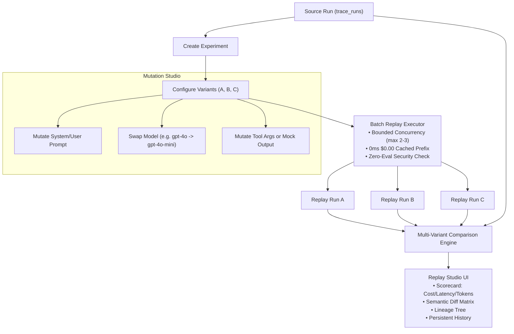

# AetherTrace Architecture: Phase 12 Audit & Baseline
## Replay & Experiment Studio

> **Document Type:** Phase 12 Architectural Audit & Baseline  
> **Target Release:** AetherTrace v0.2.0 (Phase 12 — Replay & Experiment Studio)  
> **Status:** Completed & Approved  
> **Author:** AetherTrace Core Architecture  
> **Date:** October 2026  

---

## 1. Executive Context

In Phase 4, AetherTrace implemented foundational time-travel replay and single-span forking:
- Developers could pause at breakpoints, mutate a prompt in `InspectorDrawer`, and create an isolated fork.
- Ancestors were cloned into a new run with `cache_hit: 1`, $0.00 spend, and 0ms latency.
- In Phase 5, the Diff Arena enabled pairwise run comparison (`computeRunDiff`) with Needleman-Wunsch alignment and cost/latency delta scorecards.
- In Phase 7, strict security guardrails were erected: zero-eval sandboxing, SSRF shielding, tool execution safety policies (`pure`, `read_only`, `mutating`), and explicit live confirmation.
- In Phase 11, deterministic Agent Intelligence provided deep understanding of agent hierarchies, tool chains, concurrency, retries, critical paths, and causality.

**The Phase 12 Goal:**
Transition AetherTrace from ad-hoc single-run replay to a **Replay & Experiment Studio**:
```text
SELECT SOURCE RUN
      ↓
CREATE EXPERIMENT
      ↓
DEFINE VARIANTS (Prompts, Models, Tool Mocks, Replay Configurations)
      ↓
BATCH / SINGLE REPLAY (Bounded concurrency, 0ms cached prefix, zero-eval safety)
      ↓
OBSERVE & COMPARE (Multi-variant scorecards, semantic diff, cost & latency deltas)
      ↓
ITERATE & REFINE
```

---

## 2. Inventory of Existing Foundations

### 2.1. Replay & Fork Engine (`packages/core-schema`, `apps/proxy-server`)
- **Topological Lineage Traversal:** `currId = sourceSpan.parent_span_id` backwards to root with cycle detection (`visited.has(currId)`).
- **Prefix Cloning:** Copies ancestor spans into the new run with:
  - `cache_hit = 1`
  - `latency_ms = 0`
  - `cost_usd = 0.0`
  - `execution_origin = 'cached_replay'`
  - `source_span_id = original_span.id`
- **Mutation Tracking:** `SpanMutation` schema (`span_id`, `field`, `before`, `after`) stored as JSON in `trace_runs.mutations`.
- **Replay Endpoints:**
  - `POST /api/spans/:id/fork`: Fork from span with sibling pruning and optional mutations.
  - `POST /api/spans/:id/replay`: Replay from span with safety mode checks.
  - `POST /api/runs/:id/replay`: Exact replay of an entire run.
- **WebSocket Event Bus:** Emits `RUN_CREATED`, `RUN_UPDATED`, `SPAN_CREATED`, `SPAN_UPDATED` in real time.

### 2.2. Diff & Comparison Engine (`packages/core-schema/src/diff.ts`)
- **Needleman-Wunsch Alignment:** `alignSpanSequences(baseSpans, targetSpans)` matching by hash (3.0), tool name (2.5), agent & model (2.0/1.5), and span type (0.5).
- **Span Classification:** `identical_cached`, `modified_fork`, `modified`, `inserted`, `removed`, `diverged_downstream`.
- **Scorecards:** Total cost delta, percentage savings, token count delta, latency delta, cache reuse percentage.
- **Provenance Comparison:** `compareRunProvenance(provA, provB)` checking git commit, branch, working tree cleanliness, and environment variables.

### 2.3. Security & Safety Controls (`packages/core-schema/src/security/`)
- **Tool Safety Policy:** `classifyTool(toolName)` classifying tools into `pure`, `read_only`, `mutating`, or `unknown`.
- **Replay Execution Evaluation:** `evaluateToolExecution(toolName, mode, isConfirmed)` blocking or mocking mutating tools in `cache_only` or unconfirmed replays.
- **Cost Estimation:** `estimateReplayCost(spans)` before live execution.
- **SSRF Shield & Redaction:** Private IP blocks and high-confidence credential scrubbing on all payloads.
- **Zero-Eval Sandbox:** No dynamic code evaluation or prototype pollution.

### 2.4. Agent Intelligence Engine (`packages/core-schema/src/intelligence/`)
- **Hierarchies & Summaries:** Per-agent token, cost, tool, retry, and duration tallies.
- **Critical Path DP:** Longest dependency path identifying runtime bottlenecks.
- **Tool Chains & Retries:** Multi-step tool execution grouping and failure hotspots.
- **Causal Taxonomy:** Tri-part `CAUSAL`, `STRUCTURAL`, and `TEMPORAL` classification.

### 2.5. UI Design System & Flight Deck (`apps/flight-deck`)
- **Component Primitives:** `Button`, `IconButton`, `Badge`, `StatusIndicator`, `Input`, `Select`, `Panel`, `Modal`, `Divider`, `DataRow`, `EmptyState`, `LoadingState`, `Tooltip`.
- **Tokens:** Centralized semantic borders, surfaces, typography, and status indicators in `design-system/tokens.ts`.
- **Existing Replay UI:** Basic "Fork IDE" tab inside `InspectorDrawer` allowing model and prompt JSON editing for a single span fork.
- **Diff Arena Modal:** Side-by-side run comparison with step-by-step accordion.

---

## 3. What Can Be Reused vs What Needs Extension

| Subsystem | Existing Capability | Phase 12 Extension Required |
|---|---|---|
| **Data Schema** | `trace_runs` has `parent_run_id`, `mutations`, `forked_at_span_id`. | Add structured `experiments` and `experiment_variants` tables to manage multi-variant collections. |
| **Fork / Replay** | Single-span fork and whole-run replay. | Add batch replay executor with bounded concurrency and variant mutation applier. |
| **Mutations** | Model, prompt, and request payload mutations. | Formalize `ExperimentMutation` schema supporting prompt diffs, model swap, and tool argument/mock overrides. |
| **Diff Arena** | Pairwise (Run A vs Run B) comparison. | Multi-variant scorecard (Source Run vs Variant A vs Variant B vs Variant C) in Studio and Diff Arena. |
| **Lineage** | Parent-child run pointers in `trace_runs`. | Multi-generation experiment lineage tree (Source → Experiment → Variants → Child Forks). |
| **UI** | Basic Fork tab in Inspector Drawer. | Dedicated `ExperimentStudio` workspace with variant matrix, before/after diff editor, and batch run controls. |
| **CLI** | `diff`, `inspect`, `provenance`, `reproduce`. | `aethertrace experiment <list|inspect|create|run|compare>` commands. |

---

## 4. What Must NOT Be Duplicated

1. **Do NOT rebuild the Replay Engine:** `/api/spans/:id/fork` already correctly handles prefix copying, cache hit marking, $0.00 spend assignment, and topological ancestry pruning. The variant execution engine will delegate directly to this core logic.
2. **Do NOT rebuild the Diff Engine:** `computeRunDiff` in `packages/core-schema/src/diff.ts` already computes Needleman-Wunsch alignments, cost deltas, and classifications. The multi-variant comparison will compute pairwise diffs against the source run using this existing engine.
3. **Do NOT invent a second Design System:** The Experiment Studio will strictly use `apps/flight-deck/src/design-system/` primitives and `tokens.ts`.
4. **Do NOT create a disconnected lineage model:** All replayed runs generated by variants will continue to populate `trace_runs.parent_run_id`, `trace_runs.forked_at_span_id`, and `trace_runs.mutations`, maintaining 100% interoperability with Phase 4, Phase 6, and Phase 11.

---

## 5. Backward Compatibility & Risk Analysis

### Compatibility Guarantees
- **Zero Breaking Schema Migrations:** The new `experiments` and `experiment_variants` tables use `CREATE TABLE IF NOT EXISTS` via Drizzle/SQLite and do NOT modify existing `trace_runs` or `trace_spans` columns.
- **Safe Fallback:** If an experiment or variant references a deleted or archived run, the system reports `run_not_found` cleanly without crashing or corrupting SQLite.
- **Phase 7 Security Policy Inviolability:** Batch replay respects `classifyTool` and `evaluateToolExecution`. Mutating tools will NEVER execute live without explicit confirmation.
- **Local-First & Offline:** 100% self-contained in local SQLite (`.trace.sqlite`). No cloud accounts or external scoring services.

---

## 6. Proposed Phase 12 Architecture

### 6.1. Domain Model

```text
Experiment
├── id: string (exp_<uuid>)
├── name: string
├── description?: string | null
├── source_run_id: string
├── status: 'draft' | 'queued' | 'running' | 'completed' | 'failed' | 'cancelled'
├── metadata?: string | null (JSON: tags, hypothesis)
├── created_at: number
└── updated_at: number

ExperimentVariant
├── id: string (var_<uuid>)
├── experiment_id: string (FK -> experiments.id)
├── name: string
├── description?: string | null
├── source_run_id: string
├── replay_run_id?: string | null (FK -> trace_runs.id)
├── fork_span_id?: string | null (Span where branch begins)
├── mutations: string (JSON: ExperimentMutation[])
├── replay_mode: 'cache_only' | 'live_replay' | 'mock_mutated'
├── status: 'draft' | 'queued' | 'running' | 'completed' | 'failed' | 'cancelled'
├── error_message?: string | null
├── created_at: number
└── completed_at?: number | null

ExperimentMutation
├── type: 'prompt' | 'model' | 'tool_args' | 'mock_tool' | 'custom_payload'
├── target_span_id: string
├── field: string
├── original_value: any
├── new_value: any
└── metadata?: Record<string, any>
```

### 6.2. Workflow Pipeline



This audit establishes our technical path. Implementation proceeds immediately without unnecessary abstractions or external dependencies.
