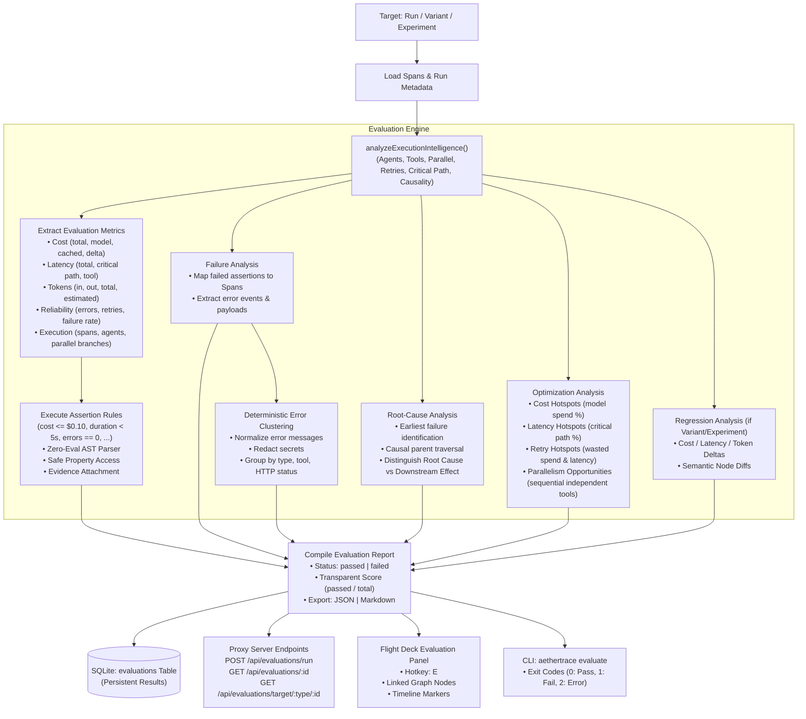

# AetherTrace Architecture: Phase 13 Readiness Audit

> **Document Type:** Architectural Audit & Readiness Assessment  
> **Target Release:** AetherTrace v0.2.0 (Phase 13 — Evaluation & Optimization Engine)  
> **Status:** Completed & Approved  
> **Author:** AetherTrace Core Architecture  
> **Date:** October 2026  

---

## 1. Executive Summary

Phase 13 marks the final feature phase of **AetherTrace v0.2.0**:
```text
Phase 11: UNDERSTAND   (Agent Intelligence, Hierarchies, Critical Path, Causality)
    ↓
Phase 12: EXPERIMENT   (Replay Studio, Variants, Mutations, Prefix Cache, Batch Pools)
    ↓
Phase 13: EVALUATE & OPTIMIZE (Deterministic Assertions, Root Causes, Optimization Signals)
```

The core objective of Phase 13 is to answer:
> **"Why did my agent perform badly, and what should I change?"**

AetherTrace must transform from an execution experimentation tool into a **local-first agent evaluation and optimization environment**.

### Primary Guardrails
- **100% Deterministic, Explainable, Local-First:** No LLM-as-a-judge, no cloud evaluators, zero `eval()`, zero `new Function()`, zero probabilistic embeddings.
- **Rooted in Empirical Trace Evidence:** Every assertion result, failure explanation, error cluster, and root-cause candidate must attach concrete span IDs, event types, and metrics.
- **Zero Disruption to Phases 0–12:** 100% backward-compatible schema additions, preserving all existing trace capture, replay, diff, search, and security capabilities.

---

## 2. Audit of Existing Evaluation-Related Capabilities

A comprehensive inspection of the monorepo identified the following foundations:

| Subsystem | File Location | Existing Capability | Phase 13 Reuse Strategy |
|---|---|---|---|
| **CI Regression Assertions** | `packages/cli/src/bin.ts`<br/>`packages/core-schema/src/types.ts` | `handleAssert` evaluates budget limits (`maxCost`) and latency SLAs (`maxLatency`), enforcing zero breaker trips. | Extend into generalized assertion DSL with exit codes (0 = pass, 1 = assertion failure, 2 = error). |
| **Zero-Eval Sandbox** | `packages/core-schema/src/security/sandbox.ts` | `safeGetProperty`, `FORBIDDEN_PROPERTY_NAMES` blocking `__proto__`, `constructor`, `prototype`, `process`, `globalThis`. | Use as the core property resolver for all assertion expressions. |
| **Expression Evaluation** | `packages/core-schema/src/types.ts` | `evaluateBreakpointCondition` resolves operators (`equals`, `not_equals`, `contains`, `starts_with`, `greater_than`, `less_than`, `exists`). | Generalize into AST/tokenized assertion evaluator with arithmetic comparisons and membership tests. |
| **Query Tokenizer** | `packages/core-schema/src/search/parser.ts` | Safe tokenization of quoted strings, duration parser (`parseDurationMs`: `5s`, `500ms`, `2m`), and numeric values. | Reuse duration and value parsers for assertion expressions. |
| **Pricing Engine** | `packages/pricing-engine/src/index.ts` | `calculateCost(model, promptTokens, completionTokens)` with model registry. | Compute total cost, model cost, cached savings, and cost deltas. |
| **Agent Intelligence** | `packages/core-schema/src/intelligence/` | Derives hierarchies (`agents.ts`), tool chains (`tools.ts`), temporal concurrency (`parallel.ts`), retry hotspots (`retries.ts`), critical path DP (`critical-path.ts`), and causal taxonomy (`causality.ts`). | Core data source for metrics, failure analysis, root-cause identification, and optimization signals. |
| **Diff Arena Engine** | `packages/core-schema/src/diff.ts` | Needleman-Wunsch span sequence alignment, cost/latency/token delta scorecards, and step classification. | Reuse for regression evaluation (baseline vs variant, multi-variant matrices). |
| **Experiment Studio** | `packages/core-schema/src/experiments.ts` | `compareExperimentVariants` multi-variant scorecard generation ($< 10\text{ms}$ SLA), prefix caching, and lineage. | Evaluate entire experiments and individual variants against baseline runs. |
| **Error Discovery** | `packages/core-schema/src/search/errors.ts` | `discoverErrors` groups error events across runs. | Base for deterministic error clustering and normalization. |
| **Credential Redaction** | `packages/core-schema/src/security/redaction.ts` | Deep recursive scanning and redaction of secrets. | Ensure evaluation reports, error clusters, and exports leak zero secrets. |

---

## 3. Existing Structures & APIs to Reuse

1. **`analyzeExecutionIntelligence(spans, run)`**:
   - Provides ready-made calculations for `criticalPath.durationMs`, `criticalPath.longestSpan`, `failureHotspots.totalErrors`, `failureHotspots.mostRetriedOperation`, `failureHotspots.mostFailedTool`, and `parallelGroups`.
2. **`safeGetProperty(target, path)`**:
   - Zero-eval safe property traversal preventing prototype pollution.
3. **`compareExperimentVariants(db, experimentId)` & `computeRunDiff(base, target)`**:
   - High-performance comparative diffs for regression evaluation.
4. **`redactSensitiveData(payload)`**:
   - Safe sanitization of error messages and payloads in reports.
5. **Flight Deck UI Primitives**:
   - `Badge`, `Button`, `Modal`, `DataRow`, `Panel`, `StatusIndicator`, `Select`, `Input` from `apps/flight-deck/src/design-system/`.

---

## 4. Proposed Phase 13 Architecture

The Evaluation & Optimization subsystem will reside primarily in `@aethertrace/core-schema/evaluation`:

```text
packages/core-schema/src/evaluation/
├── types.ts          # Evaluation, Assertion, Metric, Failure, Cluster, RootCause, Optimization types
├── parser.ts         # Zero-eval deterministic assertion expression parser (DSL)
├── assertions.ts     # Assertion execution engine with evidence attachment
├── metrics.ts        # Comprehensive metrics extraction (cost, latency, tokens, reliability, execution)
├── failures.ts       # Structured failure analysis linking failed assertions to concrete span evidence
├── clustering.ts     # Deterministic error clustering & secret-redacted message normalization
├── root-cause.ts     # Causal root-cause analysis (earliest failure -> causal parent -> retry -> downstream)
├── optimization.ts   # Optimization signal detection (cost, latency, retry, token, parallelism hotspots)
├── regression.ts     # Regression evaluation (baseline vs variant, experiment scorecards)
├── reports.ts        # Evaluation report generator (JSON & Markdown export)
└── engine.ts         # Master orchestrator evaluating runs, variants, and experiments
```

### Evaluation Execution Flow



---

## 5. Schema Changes & Database Migrations

To support persistent evaluations across server restarts without modifying existing tables destructively, we introduce a single SQLite table:

```sql
CREATE TABLE IF NOT EXISTS evaluations (
  id TEXT PRIMARY KEY,                 -- e.g. 'eval_<uuid>'
  name TEXT NOT NULL,                  -- Evaluation name
  description TEXT,                    -- Objective or description
  target_type TEXT NOT NULL,           -- 'run' | 'experiment' | 'variant'
  target_id TEXT NOT NULL,             -- References trace_runs.id or experiments.id or experiment_variants.id
  status TEXT NOT NULL DEFAULT 'passed',-- 'passed' | 'failed' | 'error'
  assertions_total INTEGER NOT NULL DEFAULT 0,
  assertions_passed INTEGER NOT NULL DEFAULT 0,
  assertions_failed INTEGER NOT NULL DEFAULT 0,
  metrics TEXT NOT NULL,               -- JSON-encoded EvaluationMetrics
  assertions TEXT NOT NULL,             -- JSON-encoded AssertionResult[]
  failures TEXT NOT NULL,              -- JSON-encoded FailureItem[]
  error_clusters TEXT NOT NULL,        -- JSON-encoded ErrorCluster[]
  root_causes TEXT NOT NULL,           -- JSON-encoded RootCauseCandidate[]
  optimization_signals TEXT NOT NULL,  -- JSON-encoded OptimizationSignal[]
  regression TEXT,                     -- JSON-encoded RegressionSummary (optional)
  created_at INTEGER NOT NULL,         -- Unix milliseconds
  completed_at INTEGER NOT NULL        -- Unix milliseconds
);

CREATE INDEX IF NOT EXISTS evaluations_target_idx ON evaluations(target_type, target_id);
CREATE INDEX IF NOT EXISTS evaluations_status_idx ON evaluations(status);
CREATE INDEX IF NOT EXISTS evaluations_created_at_idx ON evaluations(created_at);
```

### Non-Destructive Auto-Migration
This table will be added inside `runAutoMigration(sqlite)` in `packages/core-schema/src/db.ts` wrapped in standard SQLite `CREATE TABLE IF NOT EXISTS` safeguards.

---

## 6. Assertion DSL & Zero-Eval Enforcement

The assertion DSL supports explicit, deterministic syntax without dynamic code execution:

### Supported Syntax
```text
<field_path> <operator> <value>
```

### Supported Operators
- `==`, `!=` (Equality / Inequality)
- `<`, `<=`, `>`, `>=` (Numeric & Duration Comparison)
- `contains`, `not_contains` (Substring or Array inclusion)
- `exists`, `not_exists` (Field presence)

### Supported Field Categories
- **Cost:** `cost`, `total_cost`, `cost_usd`, `cost_delta`
- **Latency:** `duration`, `duration_ms`, `latency_ms`, `critical_path_ms`
- **Tokens:** `tokens.total`, `tokens.prompt`, `tokens.completion`, `tokens.estimated`
- **Reliability:** `errors.count`, `retries.count`, `failure_rate`, `breakers_tripped`
- **Execution:** `spans.count`, `spans.failed`, `agents.count`, `agent_depth`, `parallel_branches.count`, `tools.count`
- **Tool Existence:** `tool_calls.<tool_name>`, `tools.contains("<tool_name>")`
- **Span Existence:** `required_span_exists`, `forbidden_span_exists`

### Zero-Eval Safeguard
All fields are resolved strictly through `safeGetProperty(metricsContext, field)` which verifies against `FORBIDDEN_PROPERTY_NAMES`. No string concatenation to `eval()`, `new Function()`, or vm contexts is permitted.

---

## 7. Scope Boundaries & What NOT to Build

- **NO LLM-as-a-judge:** Evaluation logic is 100% mathematical, causal, and structural.
- **NO Cloud Services / Telemetry SaaS:** Runs entirely within the local Node.js / SQLite process.
- **NO Automatic Source Mutation:** Optimization signals are informative diagnostics for the developer, never automatic code refactoring.
- **NO Scope Creep into Phase 14:** No OpenTelemetry exporters, no framework-specific wrappers (LangChain, CrewAI), no external distributed workers.
- **NO Cosmetic UI Overhaul:** Reuses existing Phase 9 design primitives (`design-system/`) and standard 48px TopBar layout.

---

## 8. Implementation Steps Order

1. **Schema & Domain Types:**
   - Define `evaluations` table in `schema.ts`.
   - Add non-destructive migration in `db.ts`.
   - Define evaluation domain types in `packages/core-schema/src/evaluation/types.ts`.
2. **Core Evaluation Engine:**
   - Implement zero-eval DSL parser (`parser.ts`).
   - Implement metrics extraction layer (`metrics.ts`).
   - Implement assertion execution with structured evidence (`assertions.ts`).
   - Implement failure analysis & localization (`failures.ts`).
   - Implement deterministic error clustering with secret redaction (`clustering.ts`).
   - Implement causal root-cause analyzer (`root-cause.ts`).
   - Implement optimization signals detector (`optimization.ts`).
   - Implement regression comparison evaluator (`regression.ts`).
   - Implement evaluation report generator with JSON/Markdown export (`reports.ts`).
   - Implement master orchestrator (`engine.ts`).
3. **Proxy Server Route Handlers:**
   - Create `apps/proxy-server/src/routes/evaluations.ts` (`POST /api/evaluations/run`, `GET /api/evaluations/:id`, `GET /api/evaluations/target/:type/:id`, `GET /api/evaluations`, `GET /api/evaluations/:id/export`).
   - Mount router in `apps/proxy-server/src/index.ts`.
4. **Flight Deck UI Integration:**
   - Add API methods in `apps/flight-deck/src/lib/api.ts`.
   - Create `apps/flight-deck/src/components/EvaluationPanel.tsx` (compact modal/panel with assertions, metrics, root cause, optimization signals, and direct deep-linking to spans in DAG/Timeline).
   - Wire `TopBar.tsx` (`Evaluate` button with hotkey `E`).
   - Wire `page.tsx` state and keyboard listeners.
   - Wire `CommandPalette.tsx` commands (`Evaluate Run`, `View Evaluation`, etc.).
5. **CLI Integration:**
   - Add `aethertrace evaluate` commands (`run`, `inspect`, `assert`, `failures`, `optimize`, `compare`, `export`).
   - Ensure CI-friendly exit codes (0 = pass, 1 = assertion failure, 2 = error).
6. **Testing & Verification:**
   - Create comprehensive test suite in `examples/phase13-evaluation-test.ts`.
   - Benchmark performance across 100, 1k, and 10k spans.
   - Verify full regression matrix (`check-types`, `build`, `smoke`, `e2e`, `phase1` - `phase13`).
7. **Documentation:**
   - Create `docs/architecture/evaluation-optimization.md`.
   - Create `docs/architecture/phase13-completion-report.md`.
   - Update `docs/architecture/current-state.md` and `CHANGELOG.md`.
