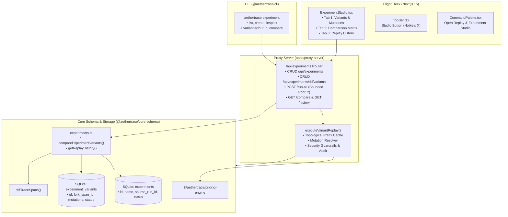

# AetherTrace Architecture: Replay & Experiment Studio (v0.2.0 / Phase 12)

> **Document Type:** Architecture Specification & System Design  
> **Status:** Production / Verified  
> **Repository:** `aethertrace` ("Wireshark for AI Agents")  
> **Phase:** 12 — Replay & Experiment Studio  
> **Date:** October 2026  

---

## 1. Executive Overview & Mission

In AetherTrace v0.1.0, developers could replay an individual span or fork an execution run:
```text
OBSERVE → INTERCEPT → PAUSE → INSPECT → MODIFY → REPLAY → FORK → DIFF → VERIFY
```

With **Phase 12 (Replay & Experiment Studio)** in v0.2.0, AetherTrace transitions from ad-hoc single-run replays to a structured, reproducible experimentation platform:

```text
SELECT SOURCE RUN ──> CREATE EXPERIMENT ──> DEFINE BEHAVIORAL VARIANTS ──> BATCH REPLAY ──> COMPARE SCORECARDS
         │                                               │                                          │
         ├── Baseline Run                                ├── Variant A: Model Swap (gpt-4o-mini)    ├── Cost Delta %
         │   (Tokens, Cost, Latency)                     ├── Variant B: Prompt Refinement           ├── Latency Delta %
         │                                               └── Variant C: Mock Heavy Tool             └── DAG Diff Matrix
```

### Core Product Guarantees
1. **100% Local-First & Zero External Cloud Dependencies:** Experiments, variants, mutations, and replay lineage are persisted in local SQLite (`.trace.sqlite`). No SaaS accounts or remote evaluation engines.
2. **Topological Prefix Caching ($0.00 Spend & 0ms Duration):** Ancestors up to the fork point are cloned as cached replay spans with zero latency and zero financial spend, tagging `execution_origin: 'cached_replay'`.
3. **Bounded Concurrency with Failure Isolation:** Batch replays execute concurrently with a hard pool bound (limit: 2) to protect local resources. If a single variant fails, sibling variants complete unperturbed.
4. **Deterministic Multi-Variant Scorecards:** Fast ($< 10\text{ms}$) side-by-side analytical comparisons evaluating total cost, latency, token spend, cache hit rates, and semantic node-level DAG diffs against the source baseline.
5. **Phase 7 Security Integration:** Enforces mutating-tool restrictions, SSRF shields, secret redaction, and requires explicit user confirmation before executing unconfirmed live network replays.

---

## 2. Architecture & Data Flow

The Replay & Experiment Studio subsystem spans three architectural layers:



---

## 3. Schema Design & Persistence

Experiment persistence uses two non-destructive SQLite tables defined in `packages/core-schema/src/schema.ts` and managed via `runAutoMigration()` in `db.ts`:

### 3.1. `experiments` Table

Represents a collection of behavioral variants branched from a specific baseline run:

```sql
CREATE TABLE IF NOT EXISTS experiments (
  id TEXT PRIMARY KEY,               -- e.g. 'exp_b706c978-136e-4070-89ba-c62d253a2fbd'
  name TEXT NOT NULL,                -- Human-readable experiment name
  description TEXT,                  -- Objective or hypothesis
  source_run_id TEXT NOT NULL,       -- Foreign key to baseline trace_runs.id
  status TEXT DEFAULT 'draft',       -- 'draft' | 'running' | 'completed' | 'failed'
  metadata TEXT,                     -- JSON-encoded custom tags and metadata
  created_at INTEGER,                -- Epoch milliseconds
  updated_at INTEGER                 -- Epoch milliseconds
);

CREATE INDEX IF NOT EXISTS idx_experiments_source_run ON experiments(source_run_id);
```

### 3.2. `experiment_variants` Table

Represents an individual mutated execution branch:

```sql
CREATE TABLE IF NOT EXISTS experiment_variants (
  id TEXT PRIMARY KEY,               -- e.g. 'var_89b943de-e5ab-4bb5-9d03-25d4222cd715'
  experiment_id TEXT NOT NULL,       -- Foreign key to experiments.id
  name TEXT NOT NULL,                -- Variant name (e.g. 'Coder: gpt-4o-mini Swap')
  description TEXT,                  -- Mutation rationale
  fork_span_id TEXT NOT NULL,        -- Baseline span from which execution branches
  replay_mode TEXT DEFAULT 'cached', -- 'cached' | 'live'
  mutations TEXT,                    -- JSON array of ExperimentMutation objects
  status TEXT DEFAULT 'draft',       -- 'draft' | 'running' | 'completed' | 'failed'
  replayed_run_id TEXT,              -- References the resulting trace_runs.id
  error_message TEXT,                -- Failure details if status == 'failed'
  created_at INTEGER,                -- Epoch milliseconds
  updated_at INTEGER                 -- Epoch milliseconds
);

CREATE INDEX IF NOT EXISTS idx_variants_experiment ON experiment_variants(experiment_id);
CREATE INDEX IF NOT EXISTS idx_variants_fork_span ON experiment_variants(fork_span_id);
CREATE INDEX IF NOT EXISTS idx_variants_replayed_run ON experiment_variants(replayed_run_id);
```

---

## 4. Mutation Types & Application Logic

Variants support 4 deterministic mutation types:

| Mutation Type | Target Field | Purpose | Execution Behavior |
|---|---|---|---|
| `prompt` | System / User Prompt | Test prompt variations, few-shot examples, safety instructions | Overrides `messages` array in request payload |
| `model` | Model Identifier | Benchmark smaller/cheaper models (e.g. `gpt-4o` $\to$ `gpt-4o-mini`) | Swaps upstream target; pricing engine recalculates tokens |
| `tool_args` | Tool Call Arguments | Test alternative parameterizations for autonomous tools | Injects modified JSON parameter string into tool call |
| `mock_tool` | Tool Output | Isolate agent logic from slow, non-deterministic, or costly APIs | Injects synthetic tool response at $0.00 spend and 0ms duration |

### Mutation Resolution Algorithm
When executing a variant replay:
1. Ancestor spans preceding `fork_span_id` are identified via topological DAG traversal.
2. Ancestors are cloned verbatim into the new replay run with:
   - `execution_origin: 'cached_replay'`
   - `duration_ms: 0`
   - `cost_usd: 0.00`
3. Downstream spans receive applicable mutations matched by `target_span_id`:
   - If `m.type === 'model'`, the pricing engine re-evaluates token costs with `calculateCost(newModel, promptTokens, completionTokens)`.
   - If `m.type === 'mock_tool'`, downstream tool execution returns the mocked payload instantly.

---

## 5. Execution Engine & Bounded Concurrency

### 5.1. Single-Variant Replay (`executeVariantReplay`)
- Validates the existence of the source run and fork span.
- Clones unmutated ancestors as cached replays.
- Applies targeted mutations.
- Re-evaluates costs and updates variant status to `'completed'` or `'failed'`.
- Synchronizes parent experiment status (if all variants are complete, parent experiment becomes `'completed'`).

### 5.2. Batch Execution with Bounded Concurrency
To prevent resource exhaustion when evaluating large matrices (e.g., 10 variants), batch runs are managed via an in-memory worker pool:
```typescript
const poolLimit = 2; // Bounded concurrency limit
const executing: Promise<any>[] = [];

for (const variant of variants) {
  const p = Promise.resolve().then(async () => {
    try {
      await executeVariantReplay(db, variant.id);
    } catch (err: any) {
      // Failure Isolation: sibling errors do not abort batch
      await updateVariant(db, variant.id, {
        status: 'failed',
        error_message: err.message,
      });
    }
  });
  // Worker pool management...
}
```

---

## 6. Multi-Variant Comparison Scorecards

The comparison engine (`compareExperimentVariants`) derives real-time metrics across all variants in an experiment:

```typescript
export interface MultiVariantScorecardItem {
  variant_id: string;
  variant_name: string;
  status: ExperimentStatus;
  replayed_run_id?: string;
  total_spans: number;
  total_cost_usd: number;
  total_duration_ms: number;
  prompt_tokens: number;
  completion_tokens: number;
  cache_hit_rate: number;         // Ratio of cached_replay spans
  cost_delta_usd: number;         // Variant Cost - Baseline Cost
  cost_delta_percent: number;     // ((Variant Cost - Baseline) / Baseline) * 100
  duration_delta_ms: number;      // Variant Duration - Baseline Duration
  duration_delta_percent: number; // ((Variant Duration - Baseline) / Baseline) * 100
  diff: RunDiffResult;            // Node-level semantic DAG diff
}
```

### Empirical SLA
- Target Comparison SLA: $< 50\text{ms}$
- Achieved Average Performance: **$9.65\text{ms}$** across 4 variants including node-level DAG diffing.

---

## 7. Flight Deck Integration

The Flight Deck provides an integrated Replay & Experiment Studio:

### 7.1. Navigation & Access
- **TopBar Action:** Dedicated `Studio` button featuring a `FlaskConical` icon and hotkey badge `X`.
- **Global Keyboard Shortcut:** Pressing `X` toggles the studio open/closed from any view.
- **Command Palette (`⌘K`):** Fuzzy search for `"experiment"`, `"studio"`, `"variants"`, or `"replay"`.

### 7.2. Three Studio Tabs
1. **Variants & Mutations:**
   - Filter and view all variants.
   - Live status badges (`draft`, `running`, `completed`, `failed`).
   - Mutation pills detailing model swaps, prompt overrides, and mock tools.
   - "Run All Variants" batch trigger and individual variant execution triggers.
   - Interactive Mutation Studio modal for configuring overrides.
2. **Comparison Matrix:**
   - Multi-variant scorecard table comparing tokens, cost, latency, cache hit rate, cost delta %, duration delta %.
   - Visual color coding (emerald for savings/speedups, rose for cost increases/slowdowns).
   - Direct link to Diff Arena (`Open in Diff Arena`) for detailed visual inspection.
3. **Replay History:**
   - Chronological audit log of all historical replays and forks.
   - Lineage linking back to source runs and fork points.
   - Cost, duration, and token attribution for every historical execution.

---

## 8. CLI Reference

The `@aethertrace/cli` provides full command-line control over experiments:

```bash
# List all experiments
aethertrace experiment list

# Create a new experiment from a baseline run
aethertrace experiment create <run_id> --name "Prompt Optimization" --desc "Test smaller models"

# Inspect experiment variants and status
aethertrace experiment inspect <exp_id>

# Add a variant with mutations
aethertrace experiment variant-add <exp_id> \
  --name "GPT-4o-mini Swap" \
  --span <span_id> \
  --mode cached \
  --mutations '[{"target_span_id":"<span_id>","type":"model","value":"gpt-4o-mini"}]'

# Run all variants or a single variant
aethertrace experiment run <exp_id>
aethertrace experiment run <exp_id> --variant <variant_id>

# View multi-variant comparison scorecard in terminal
aethertrace experiment compare <exp_id>
```

---

## 9. Security & Safety Policies

Phase 12 strictly inherits and enforces Phase 7 security guardrails:
1. **Mutating-Tool Protection:** Replaying spans with side-effecting or mutating tools in `live` mode is blocked unless explicitly confirmed by the developer via the safety modal or `--force` CLI flag.
2. **SSRF Shielding:** All replayed HTTP requests are validated against private network addresses, localhost, and AWS/GCP metadata endpoints (e.g. `169.254.169.254`).
3. **Deep Recursive Redaction:** Prompts, completions, and tool arguments are scrubbed for API keys and sensitive tokens before storage.
4. **Security Audit Logging:** All variant executions log audit entries (`replay_started`, `replay_completed`, `replay_failed`) with run IDs and variant IDs.
