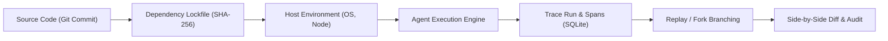
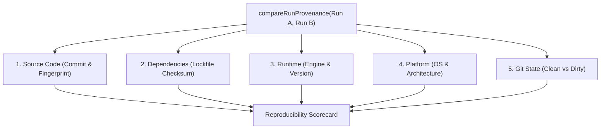

# AetherTrace — Git & Execution Reproducibility Engine Architecture

> **AetherTrace — The local debugger for AI agents.**  
> Core Loop: `OBSERVE → INTERCEPT → PAUSE → INSPECT → MODIFY → REPLAY → FORK → DIFF → VERIFY`

---

## 1. Overview & Mental Model

In AI agent engineering, non-determinism stems not only from model sampling temperatures, but also from silent shifts in the underlying execution environment: prompt templates committed in git, upgraded dependency packages, altered system runtimes, or dirty local worktrees.

When a developer inspects a historical trace run or investigates a production regression, they must be able to answer two fundamental questions with mathematical certainty:
1. **"Exactly what code, dependencies, and environment produced this run?"**
2. **"Can I reproduce, compare, and audit this run later?"**

AetherTrace establishes an unbroken lineage of provenance:



---

## 2. Core Reproducibility Guarantees & Non-Negotiables

1. **Truth Over Convenience:** Never claim a run is reproducible when provenance metadata is missing. A missing or unrecorded provenance defaults strictly to `incomplete` or `unknown`.
2. **Never Mutate Historical Truth:** Git and environment metadata describe historical runs as they occurred; past records are immutable.
3. **Local-First & Zero Git Daemon/SaaS Requirement:** Operates exclusively using standard local git commands (`git rev-parse`, `git status`). No GitHub/GitLab tokens or external APIs required.
4. **Read-Only Safety:** The CLI `reproduce` command provides clear manual instructions (`git checkout`, `pnpm install`), but **never** performs automatic checkout or mutates the developer's working directory.
5. **Absolute Secret Safety:** Secret keys, API tokens, passwords, bearer headers, and private keys are categorically denylisted and never hashed or stored in provenance metadata.

---

## 3. Provenance Data Taxonomy

Every execution run records a structured provenance snapshot stored in the `trace_runs.provenance` column and exported at the root of `.trace.json` bundles:

```typescript
export interface RunProvenance {
  git?: GitProvenance | null;
  environment?: EnvironmentProvenance | null;
  dependencies?: DependencyProvenance | null;
  reproducibility?: {
    status: ReproducibilityStatus;
    reasons?: string[];
  };
  captured_at?: number;
}
```

### 3.1 Git Provenance

Captures the precise state of the local git tree without cloning or third-party wrappers:

| Field | Type | Description |
| :--- | :--- | :--- |
| `repository_root` | `string` | Absolute path to repository root. |
| `commit_sha` | `string` | Full 40-character commit hash (`git rev-parse HEAD`). |
| `short_sha` | `string` | 7-character abbreviated commit hash. |
| `branch` | `string \| null` | Current branch name (`null` if in detached HEAD state). |
| `dirty` | `boolean` | `true` if uncommitted modifications or untracked source files exist. |
| `detached_head` | `boolean` | `true` if HEAD is directly checked out to a commit rather than a branch. |
| `git_version` | `string` | Version of local git binary. |
| `source_fingerprint` | `string` | Deterministic SHA-256 hash combining commit and sanitized status. |

### 3.2 Environment Provenance

Records the execution runtime and host platform:

| Field | Type | Description |
| :--- | :--- | :--- |
| `os` | `string` | Operating system (`linux`, `darwin`, `win32`). |
| `architecture` | `string` | CPU architecture (`x64`, `arm64`). |
| `runtime` | `{ name, version }` | Engine and version (e.g. `node v22.23.3`). |
| `package_manager` | `string` | Active package manager (`pnpm`, `npm`, `yarn`, `bun`). |
| `aethertrace_version` | `string` | Active AetherTrace framework version. |

### 3.3 Dependency Provenance

Monitors package lockfile integrity to detect silent library upgrades:

| Field | Type | Description |
| :--- | :--- | :--- |
| `lockfile_type` | `string` | Detected lockfile (`pnpm-lock.yaml`, `package-lock.json`, etc.). |
| `lockfile_fingerprint`| `string` | SHA-256 checksum of the lockfile content. |
| `lockfile_path` | `string` | Relative path to lockfile from repository root. |

---

## 4. Source Fingerprint & Secret Sanitization Algorithm

To verify that two runs were executed with identical source code even when one had uncommitted changes, AetherTrace computes a deterministic `source_fingerprint`:

1. If the repository is **clean**:
   $$\text{Fingerprint} = \text{SHA-256}("commit:" + \text{commit\_sha} + "\nclean\n")$$
2. If the repository is **dirty**:
   - Executes `git status --porcelain -u`.
   - Filters out database artifacts (`.trace.sqlite*`), test temp files, and any path matching the secret denylist.
   - Sorts changed paths lexicographically for determinism.
   - Includes sanitized `git diff -U1 HEAD` (excluding lines with secret keys or environment variables).
   - Generates SHA-256 over the composite payload.

### Secret Denylist Patterns
The following patterns are strictly excluded from git tracking, status inclusion, and fingerprint hashing:
- `api[_-]?key`, `secret`, `token`, `password`, `auth`, `bearer`
- `\.env(\..+)?$`
- `\.(pem|key|pfx|pkcs12)$`
- `id_rsa`
- `cookie`, `database[_-]?url`, `private[_-]?key`

---

## 5. Reproducibility Classification Statuses

When evaluating an individual run or comparing two runs, AetherTrace produces a classified state:

| Status | Interpretation | Action / Guidance |
| :--- | :--- | :--- |
| **`reproducible`** | Commit, lockfile, runtime, and OS match cleanly; working tree is clean. | Run can be deterministically replayed. |
| **`reproducible_with_warnings`** | Source and lockfile match, but minor platform differences detected. | Replay likely succeeds with minor timing variations. |
| **`dirty_worktree`** | Working tree contained uncommitted changes at execution time. | Stash or commit changes before replaying. |
| **`source_changed`** | Git commit or source fingerprint differs. | Check out target commit (`git checkout <sha>`). |
| **`dependencies_changed`** | Lockfile fingerprint differs. | Run package manager install (`pnpm install`). |
| **`environment_changed`** | Node.js version, OS, or CPU architecture differs. | Align runtime version with nvm/fnm. |
| **`incomplete`** | Critical provenance fields missing. | Re-run with AetherTrace >= v0.4.0. |
| **`unknown`** | Historical trace run created prior to Phase 6. | No provenance recorded. |

---

## 6. Run Comparison Scorecard

When comparing two runs (e.g. Base run vs Forked child, or CI regression trace vs local run), the comparator computes a 5-dimension scorecard:



The result is surfaced in:
- The **Side-by-Side Diff Arena** in Flight Deck (`/api/runs/:baseId/diff/:targetId`).
- The **CLI Comparator**: `aethertrace compare <run_a> <run_b>`.

---

## 7. CLI Commands

Phase 6 introduces four specialized CLI operations:

### `aethertrace inspect <run_id>`
Provides a comprehensive overview of run performance, cost, token totals, Git provenance, dependencies, and reproducibility status.

### `aethertrace provenance <run_id> [--json]`
Prints a machine-readable JSON or human-readable card of the exact execution environment.

### `aethertrace compare <run_a> <run_b>`
Renders a side-by-side terminal comparison matrix evaluating code, lockfile, runtime, and platform parity between two execution runs.

### `aethertrace reproduce <run_id>`
Analyzes the difference between the target historical run and the user's active working tree, generating safe step-by-step reproduction instructions without mutating the repository.

---

## 8. Flight Deck UI Integration

Flight Deck visualizes provenance at two critical decision points:
1. **Debugger Inspector Drawer (`InspectorDrawer.tsx`):** Displays the active run's commit hash, branch, clean/dirty badge, lockfile type, runtime environment, and reproducibility verdict badge.
2. **Diff Arena Modal (`DiffArenaModal.tsx`):** Displays side-by-side badges for Source, Lockfile, Runtime, and Platform with an interpretive status indicator.
