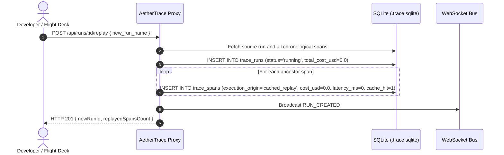
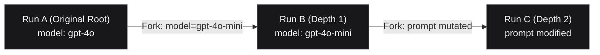

# AetherTrace — Time-Travel Debugging & Replay Engine Architecture

> **AetherTrace — The local debugger for AI agents.**  
> Core Loop: `OBSERVE → INTERCEPT → PAUSE → INSPECT → MODIFY → REPLAY → FORK → DIFF → VERIFY`

---

## 1. Overview & Architectural Philosophy

When building complex multi-agent systems, agents frequently veer off-course deep into a workflow (e.g. at step 14 of a 20-step execution). Traditional debugging techniques require either:
1. Re-running the entire agent workflow from scratch ($$$ expensive, non-deterministic, time-consuming).
2. Manually mocking dependencies with brittle local stubs.

**AetherTrace Time-Travel Debugging** solves this by treating every trace run as an immutable, replayable Directed Acyclic Graph (DAG) stored locally in SQLite with WAL mode. A developer can pause at any historical span, inspect internal state, mutate prompts or models, and branch into a new execution lineage—replaying all prior steps instantly at **$0.00 cost and 0ms latency**.

---

## 2. Execution Provenance Taxonomy

Every execution span in AetherTrace is tagged with an explicit provenance classification:

| Provenance (`execution_origin`) | Description | Cost Accounting | Latency Accounting | Cache Hit |
| :--- | :--- | :--- | :--- | :--- |
| **`original`** | Span executed live during an original session. | Actual provider spend | Real elapsed ms | `0` |
| **`cached_replay`** | Span copied from an ancestor run during replay or fork. | **$0.00** | **0ms** | **`1`** |
| **`new_execution`** | Live span emitted on top of a replayed or forked prefix. | Actual provider spend | Real elapsed ms | `0` |
| **`modified`** | Span created via human prompt or model mutation during a fork. | $0.00 prefix / live spend | 0ms prefix / real ms | `0` |
| **`mocked`** | Span intercepted at breakpoint and resolved with mock text. | **$0.00** | Interception duration | `0` |

### Truthful Cost & Latency Guarantees
- Replaying a 100-span prefix costs exactly **$0.00** and adds **0ms** to new spend.
- The new run's `total_cost_usd` only tracks fresh dollars spent on subsequent execution steps.
- Timeline visualizations distinctly label cached prefix spans (`⚡ CACHE`, `0ms`, `$0.0000`).

---

## 3. Replay Engine Workflow

When an exact replay is triggered (`POST /api/runs/:id/replay` or `POST /api/spans/:id/replay`), AetherTrace copies the targeted ancestor prefix into a new isolated run:



---

## 4. Time-Travel Forking & Topological Lineage

Forking allows a developer to branch execution at an arbitrary span $S_k$, preserving only its exact ancestry path while pruning unrelated sibling branches and downstream steps.

### Sibling & Downstream Pruning
Given an execution DAG:
- Root Coordinator
  - **Branch A:** Researcher (A1) ➔ Tool `search_docs` (A2)
  - **Branch B:** Coder (B1) ➔ Tool `write_code` (B2)

Forking at **A2** traverses topological parents `A2.parent_span_id ➔ A1.parent_span_id ➔ Root`:

```mermaid
graph TD
    subgraph Original Run
        Root["Coordinator (Root)"] --> A1["Researcher (A1)"]
        A1 --> A2["Tool: search_docs (A2)"]
        Root --> B1["Coder (B1)"]
        B1 --> B2["Tool: write_code (B2)"]
    end

    subgraph Forked Run (Fork at A2)
        F_Root["Coordinator (⚡ Cached Replay)"] --> F_A1["Researcher (⚡ Cached Replay)"]
        F_A1 --> F_A2["Tool: search_docs (🔀 Fork Point)"]
        F_A2 -.-> F_New["New Execution (✨ Live Step)"]
    end

    classDef pruned fill:#27272a,stroke:#52525b,stroke-dasharray: 4 4,color:#71717a;
    classDef kept fill:#09090b,stroke:#a1a1aa,stroke-width:1.5px,color:#f4f4f5;
    classDef live fill:#ffffff,stroke:#ffffff,color:#000000,font-weight:bold;

    class B1,B2 pruned;
    class Root,A1,A2,F_Root,F_A1,F_A2 kept;
    class F_New live;
```

---

## 5. Multi-Generation Lineage (`A → B → C`)

AetherTrace supports unlimited recursive forking. If Run A is forked into Run B with a model mutation, and Run B is subsequently forked into Run C with a prompt mutation:



The lineage endpoint (`GET /api/runs/:id/lineage`) returns:
- `root`: Root ancestor run (Run A).
- `depth`: Topological generation depth (2).
- `ancestors`: Ordered array of ancestor runs (`[Run B, Run A]`).
- `descendants`: Tree of direct and indirect child runs.
- `mutations`: Aggregated audit trail across all generations.

---

## 6. Structured Mutation Audit Trail

When an operator mutates a run, the proxy records a structured audit log in `trace_runs.mutations`:

```json
[
  {
    "span_id": "span_74a1048e-3512-4d61-95f2-f3ded39f8be7",
    "field": "model",
    "before": "gpt-4o",
    "after": "gpt-4o-mini"
  },
  {
    "span_id": "span_74a1048e-3512-4d61-95f2-f3ded39f8be7",
    "field": "prompt",
    "before": "Summarize user complaint",
    "after": "Summarize user complaint with JSON output schema"
  }
]
```

This audit trail is preserved across serialization, exported into portable `.trace.json` bundles, and displayed in the Flight Deck UI Inspector.

---

## 7. Conditional Breakpoints Engine

AetherTrace includes a safe, real-time interception engine.

### Strict Safety Constraint: Zero `eval()`
Conditional rules are evaluated strictly using deterministic property extractors and type-safe operators. **Arbitrary code execution via `eval()` or `new Function()` is prohibited.**

### Supported Rule Attributes
- **Target Span Type (`target`)**: `'all'`, `'llm_call'`, `'tool_call'`, `'http_call'`, `'guardrail_block'`.
- **Field Path (`field`)**: Any property on the span or nested JSON in request/response payloads:
  - `tool_name` (e.g. `execute_bash`, `rm_rf`)
  - `model` (e.g. `gpt-4o`, `claude-3-5-sonnet`)
  - `cost_usd` (e.g. `> 0.05`)
  - `latency_ms` (e.g. `> 5000`)
  - `agent_name` (e.g. `FinancialAnalyst`)
  - `status_code` (e.g. `429`, `500`)
  - Nested paths: `request.messages[0].content`, `payload.arguments.query`
- **Operators (`operator`)**:
  - `equals` (case-insensitive string or numeric equality)
  - `not_equals`
  - `contains` (substring match)
  - `starts_with`
  - `greater_than` (numeric threshold)
  - `less_than` (numeric threshold)
  - `exists` (non-null and non-empty check)

### Interception & Connection Holding
When a rule matches:
1. `trace_runs.status` is set to `'paused'`.
2. A `BREAKPOINT_HIT` telemetry event is broadcast via WebSocket.
3. For live LLM calls, the HTTP connection is held open in-memory (`Promise` suspended) while the operator inspects and resolves the breakpoint in the Flight Deck UI.
4. The operator can choose:
   - **▶ Resume:** Continue request to upstream provider (with optional prompt mutations).
   - **🎭 Mock ($0.00):** Inject synthetic response directly, bypassing upstream LLM.
   - **🛑 Abort:** Terminate request with synthetic error.

---

## 8. Verification & Performance SLAs

The Time-Travel Engine is verified under the 16-test suite in `examples/phase4-advanced-test.ts`:
- **Topological Traversal SLA:** Traversal across 10,000 nodes completes in **< 10ms** (< 200ms threshold).
- **Rule Evaluation SLA:** Safe condition evaluation across 10,000 spans completes in **< 10ms** (< 100ms threshold).
- **Memory Safety:** Deterministic iterative loops prevent JavaScript call-stack overflows.
