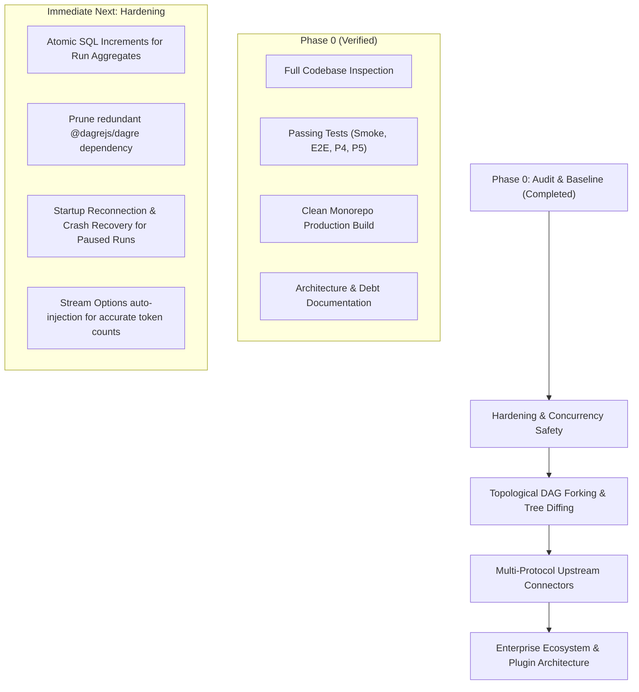

# AetherTrace Implementation Baseline & Technical Debt Audit

> **Document Type:** Technical Debt Audit & Baseline Roadmap  
> **Status:** Active / Authoritative  
> **Repository:** `aethertrace` ("Wireshark for AI Agents")  
> **Current Version:** v0.3.0  
> **Target Milestone:** Hardening & Stability Baseline  

---

## 1. Catalog of Existing Functionality

The following table catalogs all verified, operational features currently implemented in the codebase:

| Subsystem | Feature | Implementation Location | Current Status |
|---|---|---|---|
| **Proxy Server** | OpenAI-Compatible Route | `apps/proxy-server/src/routes/proxy.ts` | **Complete** (Streaming SSE & Non-Streaming) |
| **Proxy Server** | Synthetic Upstream Mock Engine | `apps/proxy-server/src/routes/proxy.ts` | **Complete** (150ms simulated delay, $0.00 test mode) |
| **Proxy Server** | WebSocket Telemetry Broadcaster | `apps/proxy-server/src/broadcaster.ts` | **Complete** (Typed broadcast to all connected UI clients) |
| **Storage** | SQLite + WAL Mode Persistence | `packages/core-schema/src/db.ts` | **Complete** (Auto-migration, Pragmas configured) |
| **Storage** | Drizzle ORM Schema | `packages/core-schema/src/schema.ts` | **Complete** (`trace_runs` & `trace_spans` with indexes) |
| **Pricing** | Multi-Provider Pricing Engine | `packages/pricing-engine/src/` | **Complete** (OpenAI, Anthropic, Local models at $0.00) |
| **Replay** | Canonical Request Hashing | `packages/core-schema/src/hash.ts` | **Complete** (Recursive key sort + SHA-256) |
| **Replay** | Instant Replay Cache | `apps/proxy-server/src/services/cache.ts` | **Complete** (0ms, $0.00 cost, streaming chunk replayer) |
| **Branching** | Time-Travel Forking | `apps/proxy-server/src/routes/traces.ts` | **Complete** (Prefix span copying & run linking) |
| **Safety** | Financial & Loop Circuit Breakers| `apps/proxy-server/src/services/breaker.ts` | **Complete** (Budget cap & 3x consecutive repeat trip) |
| **Interception** | Live HTTP Breakpoints | `apps/proxy-server/src/services/breakpoints.ts` | **Complete** (Deferred in-memory hold, WebSocket alert) |
| **Interception** | Human Mutation & Mock Resolution | `apps/proxy-server/src/routes/control.ts` | **Complete** (`resume` with mutation, `mock`, `abort`) |
| **Chaos** | Fault Injection Engine | `apps/proxy-server/src/services/chaos.ts` | **Complete** (Rate limit 429, upstream 502, latency, corrupt JSON) |
| **Diff Arena** | Run Diffing Engine | `packages/core-schema/src/diff.ts` | **Complete** (Aligment, step classification, cost savings %) |
| **CLI** | Unified Terminal Binary | `packages/cli/src/bin.ts` | **Complete** (`start`, `sim`, `diff`, `assert`, `export`, `import`) |
| **CLI** | CI Regression Assertion Gate | `packages/cli/src/bin.ts` (`handleAssert`) | **Complete** (Exits 0 on pass, 1 on SLA/budget failure) |
| **SDK** | TypeScript SDK | `packages/sdk-ts/src/index.ts` | **Complete** (`AsyncLocalStorage`, `wrapOpenAI`, traced fetch) |
| **SDK** | Python SDK | `packages/sdk-python/aethertrace/__init__.py` | **Complete** (`contextvars`, `@trace_run`, `@trace_agent`) |
| **Simulator** | Multi-Agent Simulation | `examples/multi-agent-sim.ts` | **Complete** (5-step DAG, loop breaker trip demonstration) |
| **Flight Deck UI**| Interactive React Flow DAG | `apps/flight-deck/src/components/DagCanvas.tsx` | **Complete** (Dagre layout, responsive canvas, animated edges) |
| **Flight Deck UI**| Dark Monochrome Visual Theme | `apps/flight-deck/tailwind.config.ts` | **Complete** (High-contrast white, black, zinc aesthetic) |
| **Flight Deck UI**| Live Telemetry & Inspector | `apps/flight-deck/src/components/` | **Complete** (Inspector drawer, fork IDE, breakpoint controls) |
| **Flight Deck UI**| Diff Arena Modal | `apps/flight-deck/src/components/DiffArenaModal.tsx` | **Complete** (Side-by-side run comparison, scorecard) |
| **Flight Deck UI**| Chaos Control Modal | `apps/flight-deck/src/components/ChaosModal.tsx` | **Complete** (Probability sliders & latency controls) |
| **CI** | GitHub Actions Pipeline | `.github/workflows/ci.yml` | **Complete** (Type-check, build, 4 distinct test suites) |
| **Container** | Multi-Stage Dockerfile | `Dockerfile` | **Complete** (Node 22, pnpm 9, builds both proxy & UI) |

---

## 2. Technical Debt & Code Redundancies

### 2.1. Redundant Dependencies
1. **Dagre Packaging in `apps/flight-deck`:**
   - Both `dagre: "^0.8.5"` and `@dagrejs/dagre: "^1.1.4"` are present in `apps/flight-deck/package.json`.
   - `apps/flight-deck/src/lib/layout.ts` imports from `dagre`.
   - **Remediation:** Remove `@dagrejs/dagre` from dependencies to eliminate duplicate bundle weight.

### 2.2. Token Estimation Heuristic Fragmentation
- In `apps/proxy-server/src/routes/proxy.ts`, `estimateTokens(text: string)` is defined locally as `Math.ceil(text.length / 4)`.
- It is invoked in four separate locations across mock and streaming routines.
- **Remediation:** Centralize token estimation in `@aethertrace/pricing-engine` or a shared utility module to ensure uniform fallback behavior.

### 2.3. SQLite Path Resolution in CLI vs Monorepo Root
- In `packages/core-schema/src/db.ts`, default database resolution is `resolve(process.cwd(), '.trace.sqlite')`.
- When `aethertrace` CLI is executed from arbitrary directories outside the repository root, it creates a new `.trace.sqlite` in the current working directory unless `AETHERTRACE_DB_PATH` is explicitly set.
- **Remediation:** Provide standard discovery (e.g. check parent directories for existing `.trace.sqlite` or default to `~/.aethertrace/trace.sqlite` when run globally).

---

## 3. Incomplete Features & Edge Cases

### 3.1. Non-Tree Fork Ancestor Traversal
- **Current Behavior:** In `tracesRouter.post('/spans/:id/fork')`, ancestor spans are filtered as:
  ```typescript
  priorSpans = db.select().from(trace_spans)
    .where(eq(trace_spans.run_id, sourceSpan.run_id))
    .all()
    .filter((s) => s.created_at <= sourceSpan.created_at && s.id !== sourceSpan.id);
  ```
- **Limitation:** This copies *all* spans created prior to `sourceSpan` chronologically. In a multi-agent workflow with concurrent divergent branches (e.g. Agent A and Agent B executing simultaneously), this copies sibling branch spans into the fork rather than strictly following the `parent_span_id` ancestry tree.
- **Target Solution:** Implement recursive parent-pointer traversal (`while (current.parent_span_id)`) so the forked run only contains direct topological ancestors.

### 3.2. Breakpoint State In-Memory Volatility
- **Current Behavior:** Active breakpoint promises are held in a Node.js process memory `Map<string, PendingHold>`.
- **Limitation:** If the proxy process restarts or crashes while a request is suspended, the client connection drops or hangs until socket timeout, and SQLite remains in `status: 'paused'` indefinitely.
- **Target Solution:** Add a startup reconciliation pass that checks for runs in `status: 'paused'` with spans in `status: 'intercepted'` and automatically marks them as `'aborted'` on server reboot.

### 3.3. Linear Index Alignment in Run Diffing
- **Current Behavior:** `computeRunDiff` aligns spans index-for-index (`baseSpans[i]` vs `targetSpans[i]`).
- **Limitation:** If a mutated run inserts a new intermediate span (e.g., an extra validation step or retry), all downstream steps become shifted and compared against non-equivalent operations.
- **Target Solution:** Transition from linear index alignment to tree-based or Longest Common Subsequence (LCS) DAG alignment based on `parent_span_id` and `request_hash`.

### 3.4. Streaming Usage Reporting from Upstream
- **Current Behavior:** In streaming mode, some OpenAI-compatible upstreams omit final `usage` tokens unless `stream_options: { include_usage: true }` was passed.
- **Limitation:** Without usage chunks, token counts fall back to coarse string length heuristics (`length / 4`).
- **Target Solution:** Automatically inject `stream_options: { include_usage: true }` into outbound streaming requests when forwarding to upstream.

---

## 4. Technical Risks & Guardrails

```text
┌───────────────────────────────────────────────────────────────────────────────┐
│                           CRITICAL TECHNICAL RISKS                            │
├───────────────────────────────┬───────────────────────────────────────────────┤
│ Risk                          │ Impact & Mitigation                           │
├───────────────────────────────┼───────────────────────────────────────────────┤
│ 1. Concurrent Run Aggregates  │ Risk: Two parallel spans completing at the    │
│    Race Condition             │ same millisecond read stale total_cost_usd,   │
│                               │ resulting in lost cost increments.            │
│                               │ Mitigation: Use atomic SQL updates:           │
│                               │ UPDATE trace_runs SET total_cost_usd =        │
│                               │ total_cost_usd + ? WHERE id = ?               │
├───────────────────────────────┼───────────────────────────────────────────────┤
│ 2. Single SQLite File Lock    │ Risk: SQLite write-locks during concurrent    │
│    under Heavy Concurrency    │ high-throughput agent swarms.                 │
│                               │ Mitigation: WAL mode + busy_timeout = 5000ms  │
│                               │ are already active. Ensure transactions       │
│                               │ remain minimal and non-blocking.              │
├───────────────────────────────┼───────────────────────────────────────────────┤
│ 3. Docker Process Management  │ Risk: Backgrounding proxy (`&`) in shell      │
│                               │ doesn't propagate SIGTERM on container stop.  │
│                               │ Mitigation: Use `dumb-init` or separate       │
│                               │ compose services for proxy and flight-deck.   │
├───────────────────────────────┼───────────────────────────────────────────────┤
│ 4. Stale Ports in Test Suites │ Risk: Proxy server remaining active on port   │
│                               │ 4000 causes EADDRINUSE in consecutive tests.  │
│                               │ Mitigation: Ensure all test scripts cleanly   │
│                               │ close the HTTP server in `finally` blocks.    │
└───────────────────────────────┴───────────────────────────────────────────────┘
```

---

## 5. Phased Roadmap Baseline



### Milestone Roadmap

#### Milestone 1: Concurrency Hardening & Safety (Zero Structural Disruption)
- **Objective:** Eliminate potential race conditions and edge cases in existing proxy endpoints without changing public contracts or UI designs.
- **Key Deliverables:**
  1. Replace read-modify-write pattern in `commitSpanAndRun` with atomic SQL increment (`sqlite.prepare("UPDATE trace_runs SET total_tokens = total_tokens + ?, total_cost_usd = total_cost_usd + ? WHERE id = ?")`).
  2. Add startup recovery in `apps/proxy-server` to gracefully clean up orphan `status: 'paused'` runs if the proxy was forcibly terminated.
  3. Clean up unused `@dagrejs/dagre` from `apps/flight-deck/package.json`.

#### Milestone 2: Topological DAG Forking & Smart Diffing
- **Objective:** Upgrade forking and diffing from linear chronological approximations to strict graph traversals.
- **Key Deliverables:**
  1. Recursive DAG ancestor walk in `POST /api/spans/:id/fork` to preserve only true parent lineages.
  2. Longest Common Subsequence (LCS) span alignment in `computeRunDiff` to prevent downstream misalignment when intermediate spans are inserted.

#### Milestone 3: Native Provider Adapters (Anthropic & Gemini)
- **Objective:** Allow agents configured with native Anthropic SDK or Google Gemini SDK to route directly to AetherTrace without requiring an OpenAI translation proxy.
- **Key Deliverables:**
  1. `POST /v1/messages` (Anthropic Messages API) route with automatic schema normalization and cost tracking.
  2. `POST /v1beta/models/*:generateContent` (Google Gemini API) route.

#### Milestone 4: Production Container & Orchestration Deployment
- **Objective:** Make multi-container local and self-hosted deployment turnkey.
- **Key Deliverables:**
  1. `docker-compose.yml` isolating Proxy Server (Port 4000) and Flight Deck UI (Port 3000) with shared volume for `.trace.sqlite`.
  2. Integration of process supervisor (`dumb-init`) for proper SIGTERM signal forwarding.

---

## 6. Exit Criteria Verification

All Phase 0 requirements and exit criteria are met and verified:
- [x] **Inspect entire repository:** Complete inventory across all apps, packages, examples, scripts, and configuration.
- [x] **Map current architecture:** Documented in [`docs/architecture/current-state.md`](file:///home/zlouada/Projects/wireshark-agent/docs/architecture/current-state.md).
- [x] **Catalog existing subsystems:** Proxy, SQLite, replay, fork, breakpoints, DAG, diff, CLI, SDKs, simulator, CI, Docker, UI fully documented.
- [x] **Run all tests:** `pnpm test:smoke`, `pnpm test:e2e`, `pnpm test:phase4`, and `pnpm test:phase5` executed and passing.
- [x] **Run lint/type checks:** `pnpm check-types` passed across all 6 packages with zero errors.
- [x] **Run production build:** `pnpm build` completed cleanly via Turborepo.
- [x] **Identify technical debt & risks:** Documented in Sections 2, 3, and 4 above.
- [x] **Preserve existing code:** Zero UI redesigns, zero architectural rewrites, zero unwarranted modifications.
