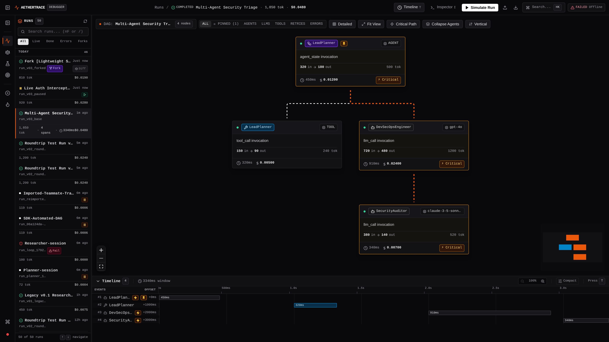
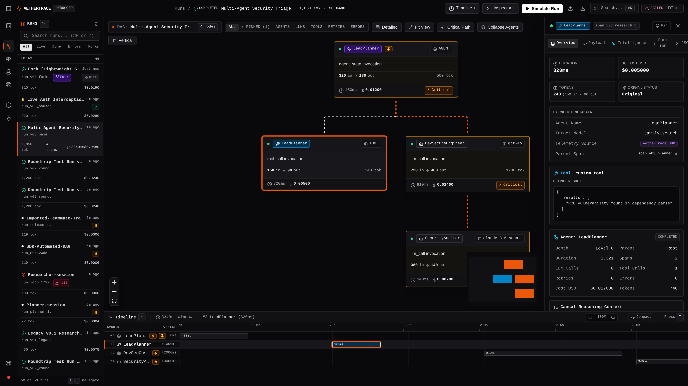
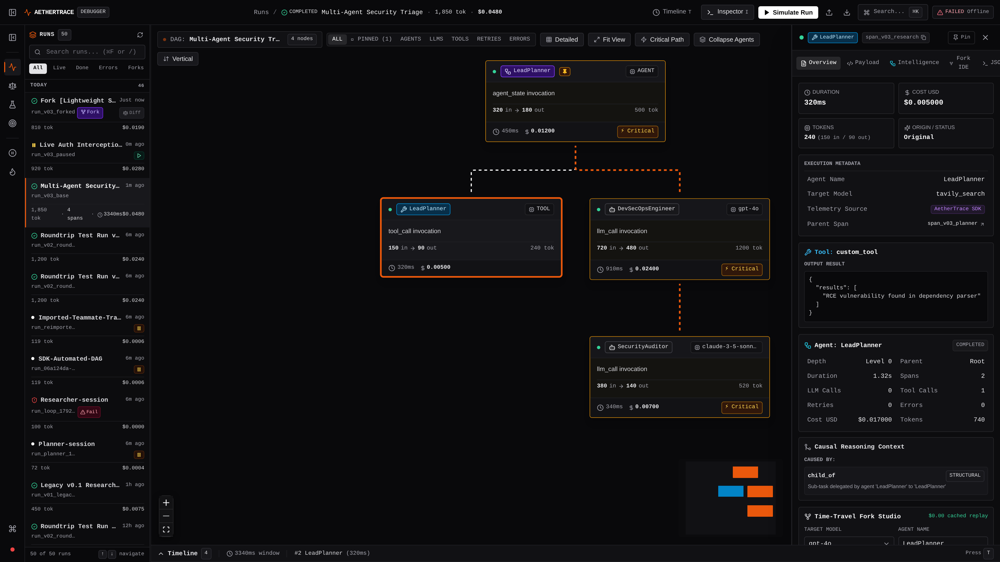
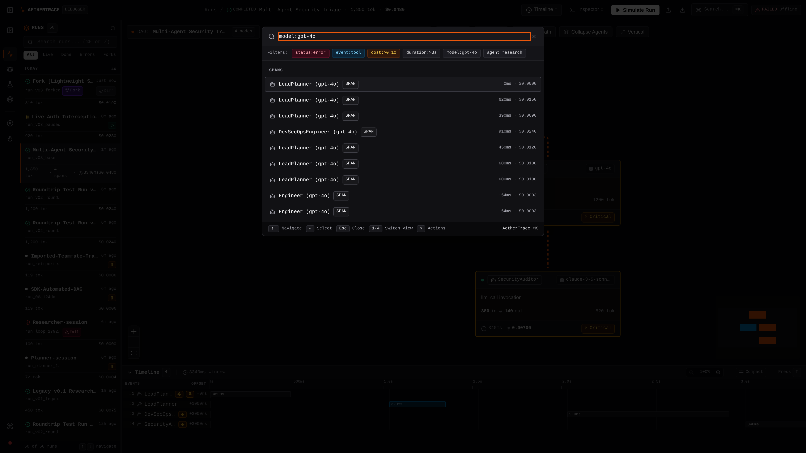
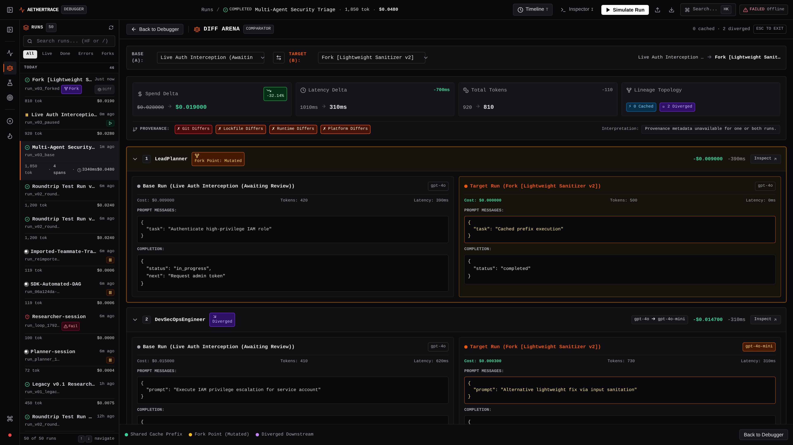
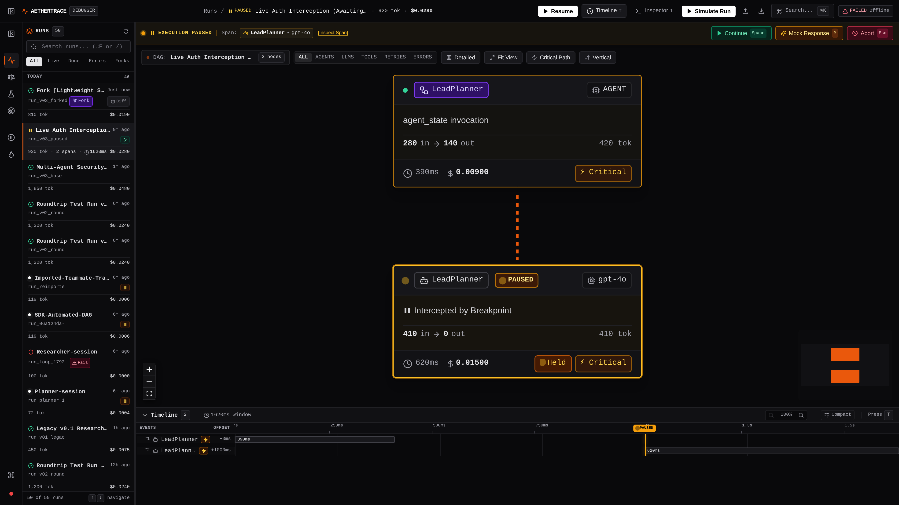
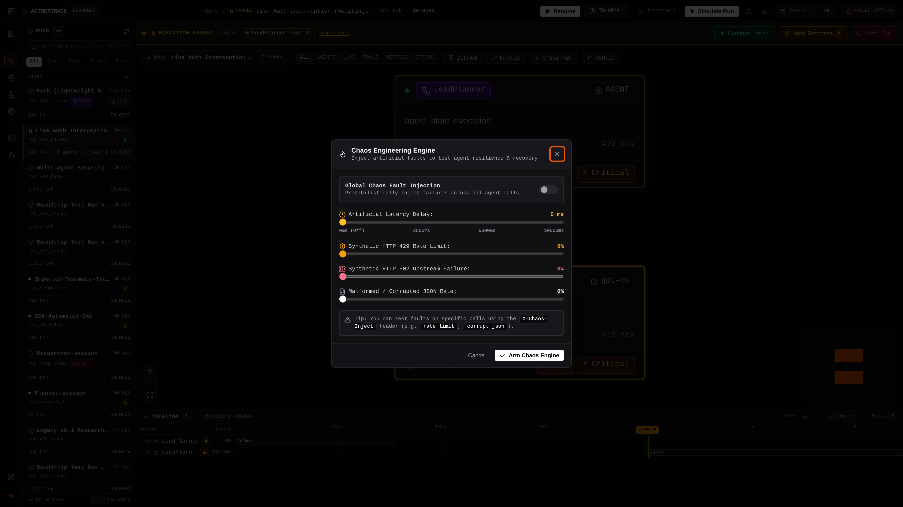
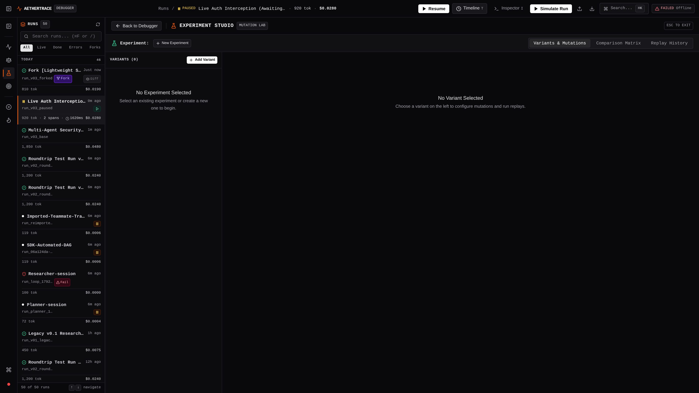
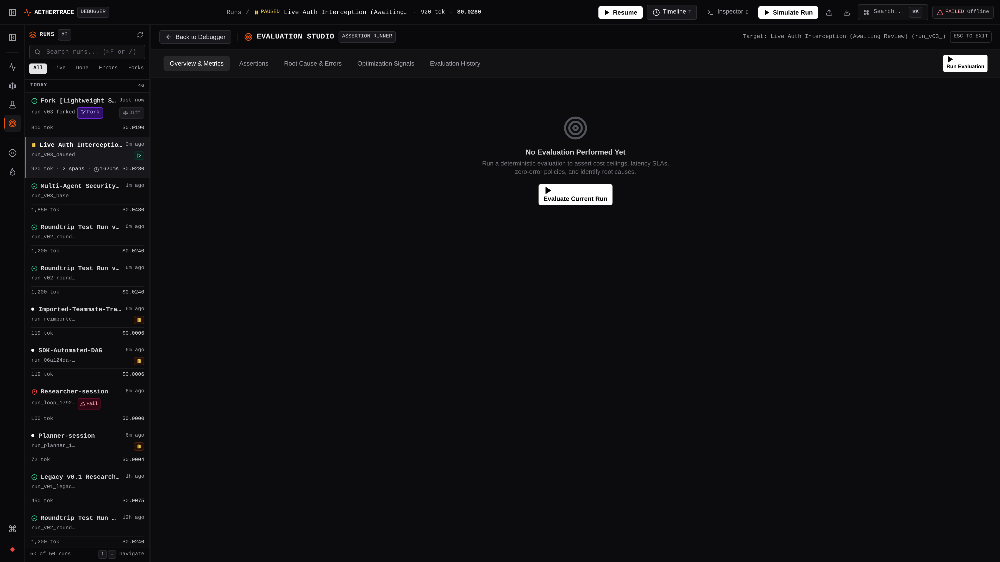
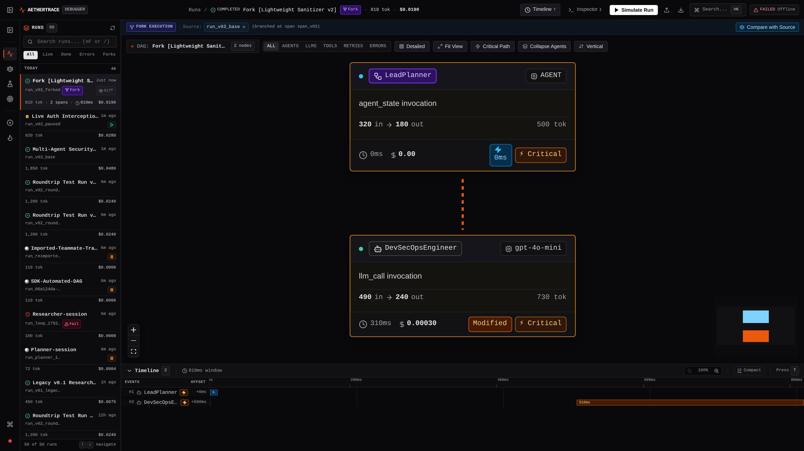

# AetherTrace v0.3.0 — UI & Feature Screenshots Gallery

This directory contains high-fidelity visual captures of the core user interfaces, debugging canvases, and diagnostic workspaces in **AetherTrace v0.3.0** ("Wireshark for AI Agents").

All captures are generated in Retina 2x resolution (1920×1080) against live local execution traces with zero mock UI artifacts.

---

## 1. Execution DAG & Workspace Shell 2.0
> **File:** `01_execution_dag.png`

The central telemetry Flight Deck workstation. Powered by `@xyflow/react` and a decoupled Dagre layout engine, featuring the compact Application Rail, consolidated TopBar, persistent resizable Run Sidebar, interactive MiniMap, quick-filter chips (Pinned, Agents, LLMs, Tools, Retries, Errors, Critical Path), and dual-density execution nodes.

### Key Capabilities:
- **Workspace Shell 2.0:** 48px application rail, collapsible run sidebar (`⌘B`), persistent panel widths, and responsive geometry.
- **Dual-Density Nodes:** Auto-switches between Compact (220×48px) and Detailed (320px) cards based on trace graph density.
- **Decoupled 0ms Layout Engine:** Visual selections, hover highlights, and pin states update with 0ms interaction latency without triggering Dagre recalculations.
- **Critical Path Highlighting:** Glowing visual accents highlighting the bottleneck dependency chain responsible for total run latency.
- **Span Pinning (`P`):** Pin key reference spans to keep them highlighted across navigation and filtering.

---

## 2. Event & Node Inspector Drawer 2.0
> **File:** `02_inspector_drawer.png`

Sliding right-side inspector drawer triggered upon selecting any node or span in the DAG canvas (or via single-key navigation `J`/`K`). Provides comprehensive audit metadata, provenance tracking, OpenTelemetry source attribution, search filter, and the interactive Time-Travel Fork & Replay IDE.

### Key Capabilities:
- **Searchable Inspector Tabs:** Overview, Prompts/Messages, Response, Lineage, and Time-Travel Fork IDE.
- **Git & Environment Provenance:** Displays exact commit hash, branch name, run ID, and span ID.
- **Resource Accounting:** Exact latency breakdown (ms), token consumption (prompt vs completion), and calculated API costs with estimated/reported indicators.
- **Structured JSON Viewer:** Formatted syntax highlighting with one-click copy actions for prompt payloads and tool call outputs.
- **Time-Travel Actions:** Dedicated **Replay From Here** and **Fork From Here** triggers to re-run from historical state at \$0.00 cost.

---

## 3. Waterfall Execution Timeline 2.0
> **File:** `03_execution_timeline.png`

A synchronized bottom-tray waterfall timeline (`T`) providing microsecond-level timing visibility across distributed multi-agent operations with zoom ruler and sticky event columns.

### Key Capabilities:
- **Zoomable Time Axis Ruler:** Horizontal zoom controls (25% to 400%) with gridlines and offset labels.
- **Sticky Event Columns:** Left-hand label strip remains fixed during horizontal scrolling.
- **Critical Path & Latency Bottleneck Isolation:** Pinpoint which tool calls or model generations are slowing down execution.
- **Bidirectional Highlighting:** Selecting a timeline bar highlights the corresponding node on the DAG canvas and vice-versa.
- **Paused Playhead Indicator:** Amber playhead marker and guideline at the exact timestamp where an execution is held.

---

## 4. Raycast-Style Command Palette 2.0 (⌘K)
> **File:** `04_command_palette_search.png`

Global search and quick-action launcher accessible via `⌘K` or `Ctrl+K`. Powered by local SQLite FTS5 (Full-Text Search) with BM25 ranking for millisecond search over millions of tokens and spans.

### Key Capabilities:
- **Semantic Filter Chips:** Quick chips for `status:error`, `event:tool`, `cost:>0.10`, `duration:>3s`, `model:gpt-4o`, `agent:research`.
- **Contextual Breakpoint Actions:** Automatically surfaces Continue (`Space`), Mock (`M`), and Abort (`Esc`) when a breakpoint is active.
- **Instant Workspace Switcher:** Quick keys `1` (Debugger), `2` (Diff), `3` (Experiments), `4` (Evaluations).
- **Full WAI-ARIA Dialog Contract:** `role="dialog"`, `role="combobox"`, `role="listbox"`, `role="option"` with focus restoration.

---

## 5. Side-by-Side Diff Arena 2.0
> **File:** `05_diff_arena.png`

Visual regression comparison workspace (`2` or `D`) that compares two runs (Baseline vs Target / Fork) side-by-side to highlight cost, latency, and structural execution differences.

### Key Capabilities:
- **Executive Delta Scorecard:** Visual comparison of financial spend, wall-clock latency, token totals, and cache reuse percentage.
- **Reproducibility & Provenance Matching:** Side-by-side diffing of Git branches, commit hashes, lockfiles, and environment runtimes.
- **Aligned Span Step Diff:** Identifies added, deleted, modified, and unchanged nodes with visual prompt/response diff highlighting.
- **First-Class Workspace:** Embedded into Workspace Shell 2.0 without modal nesting or layout breakout hacks.

---

## 6. Live Breakpoint HUD & Interceptor 2.0
> **File:** `06_breakpoint_interceptor.png`

Real-time human-in-the-loop interception interface. Halts running agents mid-flight before upstream LLM calls or tool invocations are executed.

### Key Capabilities:
- **Breakpoint HUD Banner:** High-visibility alert banner displaying pause reason, target agent, model, and one-click `[Inspect Span]` link.
- **Direct Keyboard Actions:** `Space` to Continue, `M` to inject synthetic `$0.00` mock, `Esc` to Abort execution.
- **Pulsing DAG Node Ring:** Intercepted node exhibits animated amber ring (`ring-1 ring-amber-500/70`) and `PAUSED` pill badge.
- **Zero-Eval Conditional Rules:** Safe rule expressions (`cost > 0.10`, `tool == "bash"`, `agent == "Worker"`) evaluated without risky `eval()`.

---

## 7. Chaos Engineering Studio
> **File:** `07_chaos_engineering.png`

Fault injection interface (`C`) for stress-testing multi-agent resilience, error boundaries, and recovery behaviors.

### Key Capabilities:
- **Latency Spikes:** Inject up to 10,000ms latency delays on specific agent calls.
- **HTTP 429 Rate Limiting:** Simulate provider rate limits and verify exponential backoff logic.
- **Token Truncation:** Force context window overflow faults.
- **Schema Corruption:** Test structured JSON parsing defenses against corrupt outputs.

---

## 8. Experiment Studio 2.0
> **File:** `08_experiment_studio.png`

Hyperparameter sweep and variant testing workspace (`3` or `X`). Systematically evaluate model variations, prompt iterations, and temperature settings against baseline runs.

### Key Capabilities:
- **Variant Grid:** Matrix comparing model selections, prompt adjustments, and execution status.
- **Run Lineage Tracking:** Explicitly ties every variant back to its source run and branch point span.
- **Direct Diff Launch:** One-click transition to Diff Arena to inspect execution divergences.
- **Embedded Workstation View:** Renders as a dedicated workspace within Workspace Shell 2.0.

---

## 9. Evaluation Studio 2.0 & Assertions
> **File:** `09_evaluation_studio.png`

Assertion scoring and evaluation workspace (`4` or `E`). Run deterministic rule checks, regex verifications, and LLM-as-a-judge scoring on agent execution traces.

### Key Capabilities:
- **Rule-Based & LLM Scoring:** Verify latency ceilings, cost budgets, and required tool sequences.
- **Pass / Fail Filter Chips:** Quickly isolate failed assertions.
- **Causal Culprit Span Navigation:** Click `[Culprit Spans]` to jump directly to the failing span in the Debugger workspace with Inspector opened.
- **Historical Reports:** Track regression trends across benchmark runs over time.

---

## 10. Replay Lineage & Action Feedback Banner
> **File:** `10_multi_variant_matrix.png`

Causal lineage tracking and toast feedback notification system for forked and replayed runs.

### Key Capabilities:
- **ReplayContextBanner:** Surfaces automatically above the DAG when viewing a forked or replayed execution.
- **Clickable Source Link:** Direct navigation back to the parent execution (`Source: <parent_run_id>`).
- **Branch Point Identification:** Identifies the exact span where the replay or fork originated (`branched at span <id>`).
- **Instant Comparison:** One-click `[Compare with Source]` launches Diff Arena with baseline and target pre-configured.

---

## 11. Responsive Workstation Viewports (Clean Solid Canvas)
> **Directory:** `cleanup/`

Visual verification of the workstation across standard developer display geometries following the removal of background dot/grid patterns and logo banner chrome:

- **1920 × 1080 (Desktop / Workstation)**: [`cleanup/viewport_1920x1080.png`](cleanup/viewport_1920x1080.png) — Full 4-pane layout, centered execution context, clean pitch-black canvas.
- **1440 × 900 (MacBook Pro 15")**: [`cleanup/viewport_1440x900.png`](cleanup/viewport_1440x900.png) — Proportional DAG spacing and responsive TopBar action strip.
- **1280 × 800 (MacBook Air 13")**: [`cleanup/viewport_1280x800.png`](cleanup/viewport_1280x800.png) — Resizable run sidebar and floating DAG controls without clipping.
- **1024 × 768 (Compact / Tablet)**: [`cleanup/viewport_1024x768.png`](cleanup/viewport_1024x768.png) — Compact mode with zero horizontal overflow, responsive metrics, and accessible controls.

